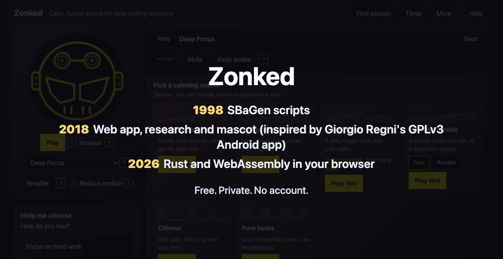

# Zonked

A free, private calm sound player for long working days and winding down. It may help some people relax. Results vary. Kiroween 2026 entry: **Resurrection** and **Best Kiro Crew App**.

Licence: MIT for the original code, with named exceptions (see "Licence and scope" below, [`LICENSE`](LICENSE) and [`NOTICE`](NOTICE)). Not a medical device. Privacy: [`docs/PRIVACY.md`](docs/PRIVACY.md). Security: [`SECURITY.md`](SECURITY.md). Release readiness: [`docs/READINESS.md`](docs/READINESS.md).

[Demo video](media/zonked-demo.mp4) (2:50)

## Try it

```bash
npm ci --prefix web
npm --prefix web run dev
```

Open the address it prints, press **Skip, just play**, read the short safety notice and accept it. Sound starts quietly and fades in.



> ## Try the Crew in 2 minutes
>
> ```bash
> npm run demo:crew
> ```
>
> This is a simulated crew feed, with the real bridge and the real app. It builds the bridge, then starts the bridge, the simulated feed and the app preview. The three agents run only inside a Kiro Crew host. Without one, you can run this demo, the bridge tests and the app in standalone mode. Open <http://localhost:4173/?crew=1>, or switch on "Connect to Kiro Crew on this computer" in Advanced. Watch the badge change to **Crew Synced** and the burnout steps move. The app follows the crew after you press **Follow crew**.
>
> The demo starts the bridge with `--min-transition 5`, which is for demos only. The default minimum transition is 30 s. For a hosted copy of the app, start the bridge with `--origin <site>` so it accepts that origin.

## First sound: how many taps

| Path | Taps |
|---|---|
| Returning person | 1 |
| Skip path | 2 |
| Normal first run | 5 |

## What is tested and what is not

- Tested, with numbers from one real run (generated by `scripts/update-counts.mjs`, not typed): see the block below. Web unit tests that stub the audio engine carry a `MOCKED` label on top of the file. Only `npm run verify:e2e` (real browser, real engine, real output peak) and the browser matrix prove what the speakers get.

<!-- counts:start -->
Numbers from one verify:all run on commit `102f9930353c` (2026-11-28). Generated by `scripts/update-counts.mjs`, do not edit by hand.

- Rust DSP tests: 65
- Web unit tests (Vitest): 645 in 59 files. Some of these stub the audio engine (labelled mocked in their file names or headers).
- Crew bridge tests: 51
- App backend tests: 35
- Script tests: 41
- Real browser checks (Playwright, Chromium, real audio engine): 38 of 38
- Browser matrix (Chromium, Firefox, WebKit builds from Playwright, 9 combinations): 162 of 162 checks
<!-- counts:end -->
- Not tested: listening by ear to the 20 recordings and 10 made-in-code sounds, real Firefox, real Safari, real phones, a real screen reader, and a live Kiro Crew host. `docs/OWNER-TEST.md` lists the steps for these.
- Publish readiness against the App Kit guide: `docs/PUBLISH-CHECKLIST.md`.

## Quick start (60 s)

```bash
cd web
npm ci
npm run build
npm run preview        # http://localhost:4173
```

The app opens on the Calm front door: five short questions, the hearing-safety notice, then a starter sound. No sound plays before you accept the notice. Today, Journeys, Library, Player, Crew and Settings sit in a tab bar, and Settings has a switch to Studio mode, the full control panel. Your choice is kept in this browser. In Studio, click the mask or press Space and accept the safety notice once. See "Requirements" below for the toolchain.

Zonked resurrects two old things. One is SBaGen (1998), the `.sbg` brainwave sequence idea. The other is the author's own 2018 final-year web application, binaural beats research and yellow mask mascot, which were inspired by Giorgio Regni's GPLv3 Android app "Binaural Beats Therapy". That Android app is credited and kept in `legacy/` as reference only. The sequence idea and the mascot now run as a Rust `no_std` WebAssembly synth inside an `AudioWorklet`, in an offline-first PWA. When run in Kiro Crew, a three-agent crew can watch your coding session and ease the sound from Beta/Gamma focus, to Alpha recovery, to Theta decompression. A library of 239 templates, a recommender, five synthesized sound layers, 22 recorded nature loops and 10 made-in-code sounds with a blend slider, a 90 second pause, a 5 minute breathing session, a focus sprint, a sleep fade, timers and lock-screen controls make it usable on its own all day.

- Demo video: `media/zonked-demo.mp4` (2:50), also `media/zonked-demo.webm`
- Pitch deck: `docs/Zonked-Kiroween-Deck.pptx` (8 slides), web backup `docs/deck.html`
- Design: [`docs/HLD.md`](docs/HLD.md), [`docs/LLD.md`](docs/LLD.md)
- Audits: `docs/notes/AUDIT-DSP.md`, `docs/notes/AUDIT-SECURITY.md`, `docs/notes/AUDIT-SPEC.md`, `docs/notes/AUDIT-HUMANITARIAN.md`
- Sounds and research: [`docs/SOUNDS.md`](docs/SOUNDS.md), [`docs/RESEARCH.md`](docs/RESEARCH.md)
- Spec: `.kiro/specs/zonked-core/` and `.kiro/specs/zonked-library/` (requirements in EARS, design, tasks, contracts)

## Free, private, for everyone

Zonked is a free calm sound player for long working days and winding down. No account, no ads, no tracking, no internet at run time (the only call is the optional crew bridge on your own computer). The engine makes the sound on your device, plus 20 bundled nature loops that play only when chosen, and 10 sounds made in code. The app works offline: 6 of the 22 loops are saved at install, and the others work offline after you have played them once online.

The Sanctuary panel (More menu) holds:

- Why Zonked is free and how it stays private, in plain words.
- A how-it-works guide: what the sound does, why headphones, how to listen safely, and what it cannot do. Zonked is not a medical device. For health problems, see a professional.
- Favorites: templates and your own mixes, one tap away.
- My mixes: save the current sound with its levels and timer, then play, rename, delete, export or import.
- Gentle milestones: first session, three calm days, ten sessions, total minutes, first full sleep fade, took a break. One missed day is forgiven. They can be hidden or reset. There are no notifications and no pressure.
- My data: export everything as one JSON file you keep, import a file (checked and clamped to the hearing-safety limits), or delete it all.

Everything is stored on this device, in the browser's localStorage and IndexedDB, plus the service worker cache. Nothing is sent anywhere. What is kept and how to delete it: [`docs/PRIVACY.md`](docs/PRIVACY.md). See also `docs/notes/AUDIT-HUMANITARIAN.md`.

## Sounds and what the research says

Pick a calming sound on the first screen: lo-fi chords, soft piano, violet noise, rain and rumble, chimes, or pure beats. The Mix view turns each part up or down, and a Calm to Alert dial moves the beat between 2.5 and 20 Hz. Everything is synthesized on your device.

The research is mixed. Some small studies report less anxiety or better focus with binaural beats or steady noise; others find no effect. Zonked labels each brainwave band with its evidence level (limited, preliminary or mixed) in the Inspect panel. Sources and their honest status are in `docs/RESEARCH.md`. Results vary and may not happen for you. Zonked is not a medical device.

## Hearing safety

Use stereo headphones for binaural beats. Start with the volume very low. Zonked is not a medical device and does not diagnose, treat or cure anything. Ask a doctor first if you have a seizure disorder, a serious mental health condition, tinnitus or sensitive hearing. Do not use it while driving or running machinery. The engine clamps carrier to 20-1500 Hz, beat offset to 0.5-40 Hz, master gain to 0.85, and hard-limits output to [-0.95, 0.95]. Playback fades in over at least 2 seconds.

## Layout

| Path | What |
|---|---|
| `crates/dsp-core` | `#![no_std]` DSP: u64 phase oscillators, isochronic/monaural, Xoshiro256** noise, smoothing, limiter, five synthesized layers |
| `crew-bridge` | Zero-dependency TypeScript CLI. Serves `.zonked-state.json` over SSE on `127.0.0.1:43210` |
| `app` | Kiro Crew app port: the Calm screens with one persistent audio engine and a Now Playing side-panel tab |
| `web` | React + TypeScript PWA, `.sbg` parser, AudioWorklet, template catalog, recommender, timers, static host config (host config file, `_headers`) |
| `.kiro` | Steering, hook, spec, Kiro Crew manifest and agent instructions |
| `docs`, `media` | Design docs, deck, demo video |
| `legacy` | Read-only reference: Giorgio Regni's GPLv3 Android app (third-party) and Gnaural schedules |

## Requirements

Node 20+ and Rust. `rust-toolchain.toml` pins the Rust version and the `wasm32-unknown-unknown` target, so `rustup` installs them for you. The wasm is built with plain `cargo`, not `wasm-pack`. Use `npm ci` (not `npm install`) so the lockfiles decide every version. Install scripts of dependencies are off, see `docs/BUILD.md`.

## Run the PWA

```bash
cd web
npm ci
npm run build          # builds WASM, type-checks, bundles to web/dist
npm run preview        # http://localhost:4173 (COOP/COEP set)
# or: npm run dev      # http://localhost:5173
```

Click the mask or press Space. Accept the safety notice once. Pick a preset or open the editor (`E`) to write `.sbg` text. After the first load the app works with the network off. Of the nature loops, 6 are ready offline at once and the other 14 after you play them once online.

Presets: Deep Focus (40 Hz gamma), Flow State (18 Hz beta), AI Burnout Reset (10 Hz alpha to 6 Hz theta), Breathwork Sync (5.5 Hz theta with a breath pacer), Deep Rest (2.5 Hz delta), Classic 1998 SBaGen Demo.

## The library

Sound comes from the engine and a few bundled loops. The engine makes beats, noise, lo-fi and piano itself. 20 short CC0 or public domain nature loops (MP3, lazy loaded) ship in the repo and play only when chosen. 6 are precached at install. The other 14 are saved for offline use the first time you play them. Each is listed with source and licence in `docs/SAMPLES-LICENSES.md`. Ten more sounds (wind, waterfall, flute, roof rain, singing bowl, soft chimes, campfire, brown noise, ocean swell, crickets) are made in the browser. A person's own sound file never leaves their device. No internet at run time.

### Templates

239 templates across categories such as vibes, healing, lucid dreams, meditation, sleep, focus and work recovery. Each template is a list of stages (beat, carrier, mode, noise, layers) that plays through the same sequencer as an `.sbg` script, so every value is clamped to the hearing-safety bounds. 215 are generated by a deterministic archetype DSL (`web/src/catalog/`), 21 follow published step values from the Android reference app and 3 from Gnaural schedules, in original wording (marked by `source`). A separate wave of this release is replacing these 24 with original schedules (see [`NOTICE`](NOTICE) and [`docs/READINESS.md`](docs/READINESS.md)). Open the catalog drawer to search by text, category, vibe, layer tag and steady-and-plain sounds, 24 per page. The catalog is a lazy chunk, loaded when first needed.

### Recommender

Pick a situation (steady focus, wind down, meditate, deep work, quick reset and others), optionally a vibe, your available minutes, and your device. The recommender scores every template (situation 40, vibe 15, duration 15, time of day 10, device 10, sensory sensitivity 10) and returns at least 5 with reasons. It is pure and deterministic. On speakers it warns about binaural templates. High sensitivity excludes intensity above 3, percussion and crackle while enough gentle matches exist. Press `R` to open it and `1` to `5` to launch a result.

### Layers

Five layers are synthesized in the WASM core and mixed under the tones: lo-fi (warm harmonic bed, tape saturation, vinyl crackle), instrument (pluck, drone, FM bell), pad (8 chords), chimes (6 inharmonic partials) and percussion (8 patterns). The Mixer drawer sets each level and shows the effective master gain. Layer levels are budgeted so total output stays under the 0.95 limiter ceiling. With all layers at 0 the output is identical to the layer-free engine.

### Timers

Countdown, sleep fade (beat glides toward 2.5 Hz and volume to 10 percent over N minutes, then a 6 second final fade and stop) and Pomodoro (25 minutes focus, 5 minutes break by default, the beat eases to 8 Hz or lower during breaks). Timer state is saved in `localStorage` (`zonked.timer.v1`) and restores paused.

### Quick Start

On first run an inline card asks how you want to feel (or what you are doing), then how many minutes you have. It lists the top 5 sounds with a reason each. Play goes through the same headphone and volume notice as the main button. Skip closes it for now. Don't show again hides it for good. Reopen it any time with Help me choose.

### Advanced mode

Technical readouts (base tone, left and right ear, beat speed, band, engine state, burnout level) and the script editor and layer mixer buttons live under Advanced. The drawer is always in the page and keeps its open state. A glossary explains terms like binaural beat and carrier in plain words.

### Tooltips

Every control has a short tip. Hover or focus shows it, tap the small ? button on touch, Escape closes it. Tips use role=tooltip and aria-describedby, stay inside the viewport and skip the fade when Reduce motion is on. All text is in `web/src/ui/copy.ts`.

### Small screens

The layout is checked at 390x844 (no sideways scroll, mascot and controls inside the screen), plus 1280x720 and 1600x900.

### Keyboard shortcuts

| Keys | Action |
|---|---|
| Space | Play or pause |
| Right or N, Left or P | Next, previous template |
| 1 to 5 | Launch recommendation 1 to 5 |
| R | Open the recommender |
| T | Cycle timer: none, countdown, sleep fade, Pomodoro |
| M | Mute or unmute |
| + or =, - or _ | Volume up, down (steps of 0.05, never above the 0.85 cap) |
| ? | Show shortcuts |
| E | Open the editor |
| B | Toggle the breathing pacer |
| Esc | Close drawers and popovers |

Shortcuts are ignored while you type in a field and when Ctrl, Cmd or Alt is held.

### Background, lock screen and Bluetooth

Audio keeps playing when the tab is hidden or the screen locks. If the browser suspends the audio context, Zonked resumes it on the next visibility change or tap, but only while it was playing. The Media Session API shows the template name and category with artwork on the lock screen and wires play, pause, stop, next, previous and 15 second seek to headset, car and Bluetooth buttons. An optional screen wake lock (stored as `zonked.wakeLock`) keeps the display on while playing; it is released when you stop or hide the page. The recommender can use the connected output device when the browser exposes its label (read only, no permission prompt).

### Mascot

The mascot tilts toward the pointer, spins when dragged, deepens on hover and reacts to loudness. With Reduce motion on it stays still.

## Run the Kiro Crew workflow

The crew talks only through files in the project root. See `.kiro/crew/crew.yaml`.

```
burnout-sentinel   -> .zonked-signals.json   (git velocity, session length, build failures, score 0-100)
acoustic-sequencer -> .zonked-state.json     (bounded target: beat, carrier, gain, transition)
dsp-verifier       -> .zonked-verify.json    (runs cargo test and clippy on dsp-core)
crew-bridge        -> http://127.0.0.1:43210 (SSE to the browser)
```

1. Register the three agents from `.kiro/crew/agents/` in Kiro Crew and schedule them as listed in `crew.yaml` (sentinel every 5 minutes, sequencer on signals change, verifier on `crates/dsp-core/**` change).
2. Start the bridge:

```bash
cd crew-bridge && npm ci && npm run build
node dist/src/cli.js --state ../.zonked-state.json
```

3. Open the PWA. The badge changes from **Standalone** to **Crew Synced** and the burnout meter follows the score. Stop the bridge and the app keeps playing in standalone mode.

No Kiro Crew host handy? Demo the loop with the simulated crew feed (real bridge, real app, no agents):

```bash
node crew-bridge/scripts/fake-crew.mjs --state .zonked-state.json --step-sec 20
```

Note on Safari and mixed content: a site served over https and the bridge is `http://localhost:43210`. Chrome and Firefox treat loopback as potentially trustworthy and allow the call. Safari blocks it as mixed content, so the app stays in Standalone mode there (the library, timers and layers all still work). Use Chrome or Firefox for Crew sync on an https site, or run the app locally.

The `.kiro/hooks/verify-dsp.json` hook runs `node scripts/check-no-buildrs.mjs && cargo test --manifest-path crates/dsp-core/Cargo.toml` whenever a file in `crates/dsp-core/` changes. Note that `cargo test` runs local code (tests, and `build.rs` or proc macros if present); the check script fails the hook if `crates/dsp-core` has a `build.rs` or proc-macro dependencies. Review pulled branches before editing in them.

## Test and verify

Sizes and counts come from the real run: `npm --prefix web run check:bundle` prints the first-load size against the 110 KB budget, and the counts block near the top of this file is generated from `verify:all`. Nothing here is typed by hand.

```bash
cargo test --manifest-path crates/dsp-core/Cargo.toml
cargo clippy --manifest-path crates/dsp-core/Cargo.toml --all-targets -- -D warnings
(cd crew-bridge && npm test)
(cd web && npm test && npm run audit:security && npm run test:scripts)
(cd web && npx vitest run --coverage)  # coverage report (v8)
(cd web && npm run build && npm run check:bundle)   # fails above 110 KB gzip
(cd web && npm run verify:e2e)      # Playwright, real engine, Chromium
(cd web && npm run record:demo)     # regenerates media/ (needs ffmpeg)
```

Bundle budget: `npm run check:bundle` gzips what `dist/index.html` loads. Lazy chunks (editor, recommender, catalog browser, mixer, timer panel, sound picker, mix view, Inspect, Sanctuary, catalog data) are listed separately.

The end to end run (`npm run verify:e2e`, Playwright against a preview server and the real bridge) covers headers, cross-origin isolation, a soft start and a stop ramp, output peak at the hottest settings and across every feeling, each synthesized layer, Crew sync and bridge stop, offline reload, hostile `.sbg` and backup files, saved mixes and favorites, timers, accessible names, no CSP violation, no request that leaves the origin, onboarding, the safety notice before any sound, nature sounds, the 90 second pause, the focus sprint and the Crew demo. Check names are in `web/scripts/e2e-*.mjs`.

## Verify everything

```bash
npm run verify:all      # every gate above plus the end to end run, with a stage table
npm run check:privacy   # private terms, emails, paths and hosting words (also in verify:all)
npm run check:chars     # no emoji, long dashes or section signs in tracked files
npm run check:sizes     # file size limits
```

`.githooks/pre-push.template` is a pre-push hook that runs `verify:all`. Copy it to `.git/hooks/pre-push` yourself if you want it.

## Hosting

The app is a static site built to `web/dist` (`cd web && npm run build`). It needs a static host that applies the headers in `web/public/_headers`.

## Credits

Zonked brings back SBaGen (1998) and the author's 2018 final-year web application, with its research and mascot. That 2018 work was inspired by Giorgio Regni's GPLv3 Android app "Binaural Beats Therapy". The app is credited in [`NOTICE`](NOTICE) and [`legacy/NOTICE.md`](legacy/NOTICE.md), and `legacy/android` is kept as reference only.

## Licence and scope

Original code, docs, templates, mascot and icons: MIT (see [`LICENSE`](LICENSE)). These items keep their own terms and are not MIT:

- `legacy/`: third-party reference material, never shipped. `legacy/android` is Giorgio Regni's GPLv3 app and keeps its own licence.
- `web/public/samples/`: nature loops under CC0 1.0 or released into the public domain by their authors. Each file is listed in [`docs/SAMPLES-LICENSES.md`](docs/SAMPLES-LICENSES.md), with saved proof pages in `docs/legal/samples/` and a takedown route.
- `web/public/fonts/`: Atkinson Hyperlegible Next under the SIL Open Font License 1.1 (`web/public/fonts/OFL.txt`).
- Third-party packages keep their own licences (see [`NOTICE`](NOTICE)).

This is not legal advice. Open questions that need a lawyer are in [`docs/READINESS.md`](docs/READINESS.md). Zonked is not a medical device.
