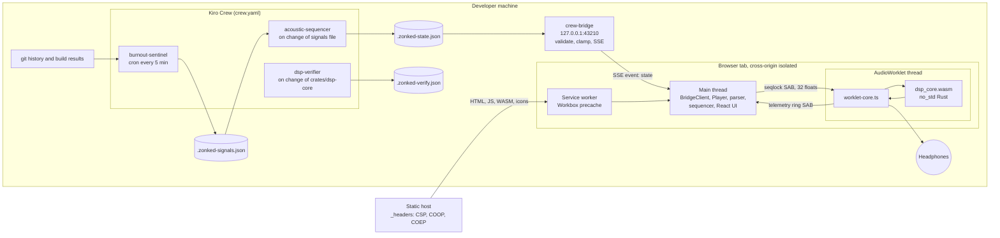
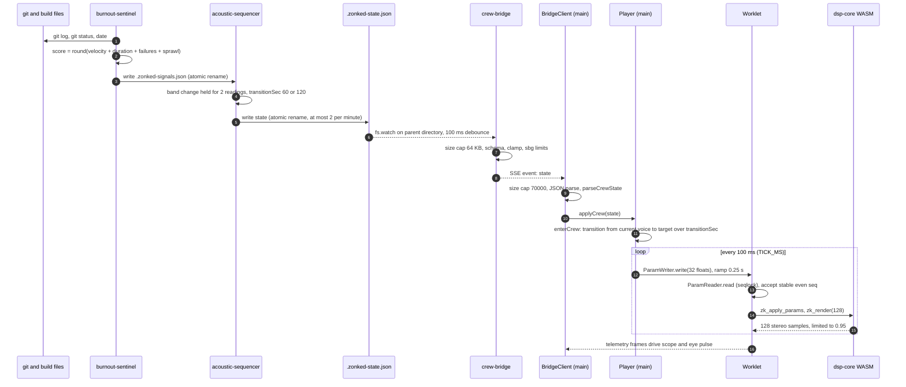
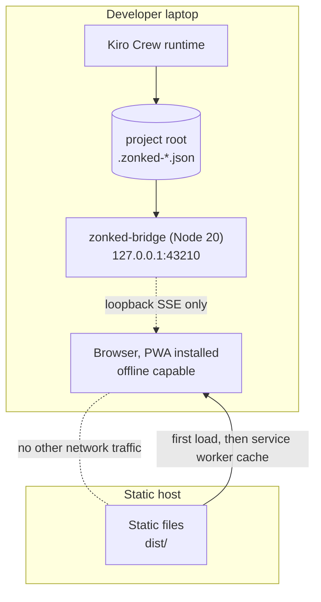
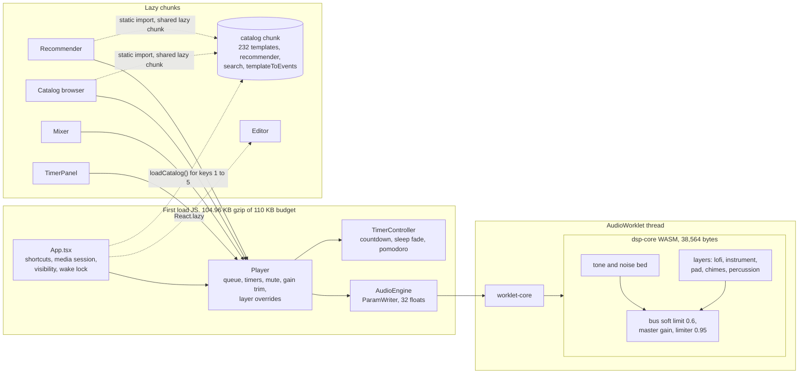
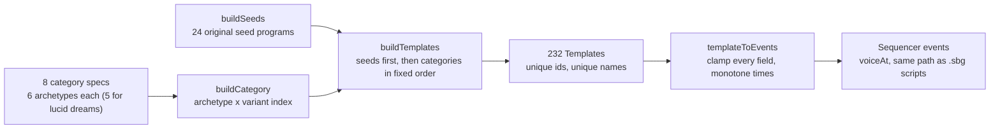
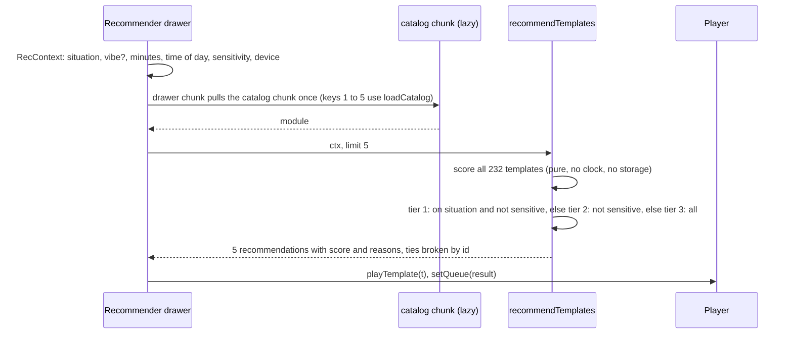
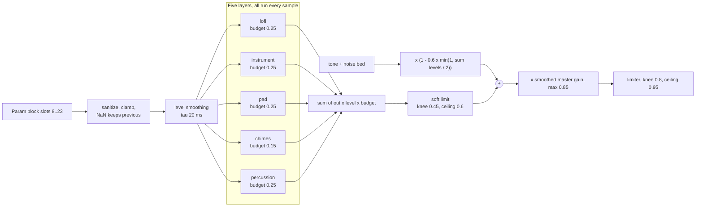
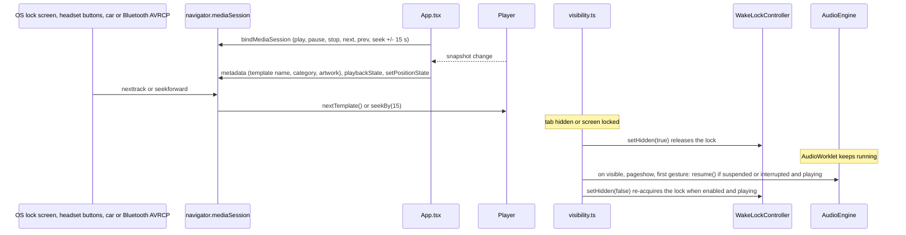

# Zonked: High-Level Design

Status: matches the code on branch `feature/zonked-library` (core plus the library: catalog, recommender, synthesized layers, timers, media session). Where code and the specs disagree, this document follows the code and says so in section 11.

## 1. Purpose

AI-assisted coding compresses hours of output into minutes of attention. The developer stays in a high-beta state with no natural pauses. Zonked is an acoustic recovery companion for that situation. It plays binaural, monaural or isochronic tones with an optional noise bed and five synthesized layers (lo-fi, instrument, pad, chimes, percussion), offers a catalog of 232 templates with a deterministic recommender and timers, and a three-agent Kiro Crew workflow steers the sound from focus (40 Hz) down to decompression (6 Hz) as measured session intensity rises.

Design goals, in priority order:

1. Hearing safety. Hard bounds are enforced in three independent layers.
2. Works fully offline and standalone. The Crew layer is optional.
3. Deterministic, allocation-free audio. A `no_std` Rust core compiled to a 38,564 byte WASM module (8,631 bytes before the layers).
4. Untrusted input everywhere: `.sbg` text, state files, bridge messages.
5. Zero third-party runtime services: no analytics, no remote scripts, no CDN, and no network at run time. The engine synthesizes beats, noise, lo-fi and piano. Seven bundled CC0 or public domain nature loops (about 1.4 MB, lazy loaded, precached) play only when chosen.

Non-goals: medical claims, accounts, cloud sync, mobile native builds.

## 2. Context

| Actor | Interaction |
|---|---|
| Developer | Wears stereo headphones, presses Play, edits `.sbg` scripts, reads the HUD |
| Kiro IDE and git history | Source of session signals read by `burnout-sentinel` |
| Kiro Crew runtime | Runs the three agents from `.kiro/crew/crew.yaml` |
| Browser (Chrome, Firefox, Safari) | Hosts the PWA, the AudioWorklet and the service worker |
| Static host | Serves the built `web/dist` with security headers from `_headers` |

The only network traffic the PWA generates is the optional loopback connection to `http://localhost:43210`. Everything else is served from its own origin and then cached.

## 3. Components

| Component | Path | Language | Job | Size or limit |
|---|---|---|---|---|
| dsp-core | `crates/dsp-core/` | Rust `no_std`, wasm32 | Oscillators, noise, smoothing, limiter, five synthesized layers, plain C ABI | 38,564 byte WASM, 32 f32 param slots, 128 frame render |
| Worklet | `web/src/audio/worklet.ts`, `worklet-core.ts` | TypeScript | Hosts WASM in the audio thread, reads params, writes telemetry | 4,273 byte bundle |
| Engine controller | `web/src/audio/engine.ts` | TypeScript | Builds the audio graph, start and stop ramps, param writes | 2 s start ramp, 0.3 s stop ramp |
| Param protocol | `web/src/audio/params.ts` | TypeScript | Seqlock over SharedArrayBuffer, postMessage fallback | 132 byte SAB (4 + 32 x 4) |
| Telemetry ring | `web/src/audio/telemetry.ts` | TypeScript | SPSC ring for the oscilloscope | 8192 frames, 65,544 bytes |
| `.sbg` parser | `web/src/sbg/` | TypeScript | Lexer, parser, sequencer, six presets | 256 KB, 500 events, 512 chars per line |
| Player | `web/src/app/player.ts` | TypeScript | 100 ms tick, script, template or crew transition, queue, mute, volume, layer overrides, session log | `TICK_MS = 100`, `MAX_GAIN = 0.85` |
| Catalog | `web/src/catalog/` | TypeScript, pure | Template DSL, 232 generated templates, recommender, search, `templateToEvents` | lazy chunk, 36.4 KB raw, 11.05 KB gzip |
| Timers | `web/src/app/timers.ts` | TypeScript, pure | Countdown, sleep fade, Pomodoro on an injected clock, persisted paused | `zonked.timer.v1`, 500 ms poll |
| Media and lifecycle | `web/src/app/mediaSession.ts`, `wakeLock.ts`, `visibility.ts`, `shortcuts.ts` | TypeScript | Lock-screen controls, wake lock, audio recovery, keyboard table | seek step 15 s |
| Crew client | `web/src/ui/bridgeClient.ts`, `web/src/app/crew.ts` | TypeScript | SSE client with backoff, re-validates every message | backoff 1 s to 30 s |
| UI | `web/src/ui/` | React 19 | Mascot with pulsing eyes, scope and Lissajous, HUD, pacer, editor, safety gate | 3 flashes per second cap |
| Storage | `web/src/storage/` | TypeScript | IndexedDB `zonked` v1 (`scripts`, `logs`), localStorage flags | in-memory fallback |
| crew-bridge | `crew-bridge/` | TypeScript, Node 20 | File watcher, validator, SSE server | zero runtime dependencies, 127.0.0.1:43210 |
| Crew agents | `.kiro/crew/agents/` | Markdown | `burnout-sentinel`, `acoustic-sequencer`, `dsp-verifier` | file-only communication |
| Host config | host config file in `web/`, `web/public/_headers` | TOML, headers | static host, CSP, COOP, COEP | SPA fallback |

## 4. Architecture diagrams

### 4.1 End-to-end data flow



### 4.2 Sequence: a burnout transition



### 4.3 Hosting



## 5. Data contracts

| Id | Contract | Defined in |
|---|---|---|
| C1 | WASM ABI: 8 exports (adds `zk_param_count`), 32 f32 param slots (8 to 23 are layers), 128 sample buffers | `.kiro/specs/zonked-core/contracts.md`, `.kiro/specs/zonked-library/contracts.md`, `crates/dsp-core/src/abi.rs` |
| C2 | Parser API: `parseSbg`, `voiceAt`, `LIMITS`, `PRESETS` | `web/src/sbg/` |
| C3 | Crew state JSON and bridge endpoints | `crew-bridge/src/validate.ts`, `web/src/app/crew.ts` |
| C4 | Param protocol (seqlock) and telemetry ring | `web/src/audio/params.ts`, `telemetry.ts` |
| L-C3 | Catalog types, `recommendTemplates`, `searchTemplates`, `templateToEvents` | `web/src/catalog/types.ts`, `recommend.ts`, `events.ts` |
| L-C4 | Timer and player additions | `web/src/app/timers.ts`, `player.ts` |
| L-C5 | Shortcut table | `web/src/app/shortcuts.ts` |

Crew state (C3):

```json
{
  "version": 1,
  "at": 1790000000,
  "burnout": { "score": 66, "level": "recovery" },
  "target": {
    "presetId": "burnout-reset",
    "beatHz": 10,
    "carrierHz": 200,
    "gain": 0.5,
    "transitionSec": 60,
    "breathe": true
  },
  "sbg": null
}
```

Bridge endpoints: `GET /events` (SSE, `event: state` and `event: ping`), `GET /state`, `GET /health` returning `{ ok, hasState, lastError, warnings[], clients }`. Full byte-level details are in `docs/LLD.md`.

Safety bounds shared by every layer:

| Parameter | Range | Behavior |
|---|---|---|
| Carrier | 20 to 1500 Hz | clamp |
| Beat offset | 0.5 to 40 Hz | clamp |
| Master gain | 0 to 0.85 | clamp |
| Output sample | -0.95 to 0.95 | limiter then hard clamp |
| Start ramp | at least 2 s | `START_RAMP_SEC = 2` |
| Stop ramp | at least 250 ms | `STOP_RAMP_SEC = 0.3` |

## 6. Resurrection story

Zonked is a revival, not a rewrite for its own sake.

| Year | Artifact | What survived |
|---|---|---|
| 1998 | SBaGen: text-script binaural beat generator | The sequence language. Zonked parses a safe subset: tone-sets, timed lines, `->` ramps. The `Classic 1998 SBaGen Demo` preset is a fifteen minute script in that style. |
| 2018 | The author's final-year web application, binaural beats research and yellow mask mascot, made after studying Giorgio Regni's GPLv3 Android app "Binaural Beats Therapy" and Gnaural schedules. Those third-party sources are kept in `legacy/` as reference only (GPLv3, read-only, see `NOTICE`) | The mascot concept, the research, and the lesson that a phone app cannot see what a developer is doing |
| 2026 | Rust `no_std` WASM DSP in an AudioWorklet, PWA, Kiro Crew steering | Same tones, now deterministic, bounded, installable, and driven by coding-session intensity instead of a timer |

The mascot is redrawn as `web/public/logo.svg` with separable eye elements. The eyes pulse at the beat, mapped to at most 3 Hz by `visibleHz(f) = f / ceil(f / 3)`.

## 7. How Kiro is used

| Kiro feature | Where | Effect |
|---|---|---|
| Specs | `.kiro/specs/zonked-core/` (requirements in EARS, design, tasks, contracts) | Scope source of truth. Work proceeded phase by phase against `tasks.md`. |
| Steering | `.kiro/steering/zonked-standards.md` (`inclusion: always`) | Binding rules for DSP, hearing safety, web security, bridge, code quality. A change that breaks one is a defect even if tests pass. |
| Hooks | `.kiro/hooks/verify-dsp.json` | On edit of `crates/dsp-core/**/*.rs` or `Cargo.toml`, runs `cargo test --manifest-path crates/dsp-core/Cargo.toml` |
| Crew | `.kiro/crew/crew.yaml` and three agent files | Runtime multi-agent workflow: sentinel (cron), sequencer (file trigger), verifier (file trigger). Agents have explicit tool lists and shell allow-lists. |
| Subagents | Build time | Parallel specialists built DSP, bridge, audio layer, parser, UI and docs against the shared contracts |
| `AGENTS.md` | repo root | The map: layout, hard rules, commands, workflow |

Crew agents exchange data only through files, so no agent needs network access and each step can be inspected, replayed and tested with `crew-bridge/scripts/fake-crew.mjs`, a simulated crew feed (real bridge, real app). The three agents run only inside a Kiro Crew host.

## 8. Offline strategy

1. `vite-plugin-pwa` (`generateSW`, `registerType: 'autoUpdate'`) precaches `html, js, css, wasm, svg, png, webmanifest, ico` with `navigateFallback: 'index.html'` and `cleanupOutdatedCaches: true`.
2. The WASM binary and the worklet are ordinary hashed assets, so they are in the precache. Audio needs no network after first load.
3. `_headers` marks `/index.html`, `/sw.js`, `/registerSW.js` and `/manifest.webmanifest` as `no-cache` so updates are discovered, and `/assets/*` as immutable for one year.
4. User data lives in IndexedDB (`scripts`, `logs`) with an in-memory fallback when IndexedDB is unavailable. Flags (`zonked.safety.v1`, `zonked.reduceMotion`, `zonked.wakeLock`) and the timer state (`zonked.timer.v1`) use localStorage and never throw. The catalog chunk and the lazy drawer chunks are hashed assets, so they are precached and the whole library works offline.
5. The bridge is optional. When `EventSource` errors, the UI shows `Standalone`, keeps playing, and retries with backoff `min(30000, 1000 * 2^attempt)` ms.

## 9. Security posture

Layered, each layer sufficient for its own bound:

- Edge: CSP `default-src 'self'; script-src 'self' 'wasm-unsafe-eval'; worker-src 'self'; style-src 'self'; connect-src 'self' ws://localhost:43210 http://localhost:43210; object-src 'none'; base-uri 'none'; frame-ancestors 'none'`, plus COOP `same-origin`, COEP `require-corp`, CORP `same-origin`, `X-Content-Type-Options: nosniff`, `Referrer-Policy: no-referrer`, `X-Frame-Options: DENY`, and a Permissions-Policy that denies camera, microphone and geolocation.
- Bridge: loopback bind, Host allow-list, Origin allow-list, GET/HEAD/OPTIONS only, read-only toward the project.
- Parsers: hard size and count limits, line-numbered diagnostics, never execute input.
- DSP: clamps, non-finite sanitizing, limiter, zero panics. The layer bus is soft-limited to 0.6 before the master gain, so layers cannot raise the worst case above 0.935 before the limiter.
- Library: no remote audio. Layer sound is synthesized in the WASM module. Seven bundled nature loops (about 1.4 MB, MP3, same origin, listed in `docs/SAMPLES-LICENSES.md`) load only when chosen. A person's own sound file stays on their device. The CSP `default-src 'self'` would block a remote media request anyway. Template data is built in code, not fetched. Timer state in localStorage is parsed defensively (version check, clamped minutes) and restores paused.

A static audit (`web/scripts/audit-security.mjs`) fails on `eval`, `new Function`, inline scripts, `innerHTML` assignment, external URLs and header drift. The threat model is in `docs/LLD.md`.

## 10. Risks

| Risk | Likelihood | Impact | Mitigation | Residual |
|---|---|---|---|---|
| Hearing harm from loud or harsh output | Low | High | Three clamp layers, limiter at 0.95, gain cap 0.85, 2 s start ramp, safety gate | Headphone volume is outside the app |
| Safari blocks https page to `http://127.0.0.1` | High on Safari | Low | App falls back to Standalone. Chrome and Firefox work. Local dev over `http://localhost:5173` works everywhere. | Safari users lose Crew sync on an https site |
| COEP misconfiguration disables SharedArrayBuffer | Medium | Medium | `postMessage` fallback for params, telemetry is empty instead of failing | Scope is blank in fallback mode |
| Hostile or corrupt state file | Medium | Low | 64 KB cap, strict schema, fresh object, bounded values, `sbg` re-checked | A valid but unhelpful state still changes the sound within safe bounds |
| Photosensitive users | Low | High | Reduce motion mode, 3 Hz visible cap, safety notice | Not a clinical guarantee |
| Agents misbehave or disagree | Medium | Low | File contracts, at most 2 writes per minute, hysteresis, bridge clamps | Sentinel score is a heuristic, not a measurement of health |
| Browser autoplay and AudioContext policy | Medium | Low | Start only from a user gesture | None |
| Layers sum above the safe level | Low | High | Per-layer budget (0.25, 0.25, 0.25, 0.15, 0.25), bus soft limit 0.6, tone bed scale down to 0.5, master gain 0.85, limiter 0.95, tested at maximum levels | Percussion transients are loud relative to the bed, which a high sensitivity filter avoids |
| Background audio stops (iOS or battery saver suspends the context) | Medium | Low | `recoverAudio` resumes on `visibilitychange`, `pageshow` and the next gesture while playing | A browser that refuses to resume needs one tap |
| Wake lock drains battery | Low | Low | Opt-in, held only while playing and visible, released on stop and when hidden | None |
| Stale timer restored after a long absence | Low | Low | Restore is always paused and clamps elapsed time inside the segment | User must press play |
| Supply chain (npm, cargo) | Low | Medium | Zero runtime deps in bridge and DSP, pinned lockfiles, no remote scripts | Build-time dev dependencies |

## 11. Where the code departs from the earlier spec

| Spec statement | Code | Document follows |
|---|---|---|
| `design.md` says the param block has 12 floats | 8 slots (`PARAM_SLOTS = 8`, `PARAM_COUNT = 8`) matching contract C1 | code |
| `design.md` says 5th-order sine polynomial, error under 1e-4 | 7th-order odd polynomial, measured max about 8.2e-7 | code |
| `design.md` says `inc = round(f / sr * 2^64)` | `(hz as f64 * k) as u64` truncates, `k = 2^64 / sr` | code |
| `design.md` says `wasm-pack build --target web` | Plain `cargo build --target wasm32-unknown-unknown --release` (wasm-pack refuses crates without wasm-bindgen) | code and `crates/dsp-core/README.md` |
| `design.md` lists `zk_set_params(ptr)` | `zk_apply_params()` reads the block returned by `zk_param_block()` | contract C1 |
| `design.md` lists `ui/app.ts`, `mask.ts` | React components in `web/src/ui/*.tsx` | code |
| Sequencer example JSON shows score 54 for the example signals | The documented formula gives 46 for those signals | formula |
| `crew.yaml` `min_transition_seconds: 30` | Bridge accepts `transitionSec` 5 to 600 | both: sequencer agent enforces 30, bridge enforces the safe outer range |
| Bridge `presetId` up to 32 chars | `web/src/app/crew.ts` accepts up to 64 | bridge is stricter and runs first |
| Library `design.md`: timers run on a 10 Hz tick | `TimerController` polls every 500 ms (`POLL_MS`) and recomputes elapsed time from the clock on every read. The Player tick that applies timer effects is 100 ms (`TICK_MS`) | code |
| Library `design.md`: tone bed scaled by 0.6 when layers play | Tone and noise bed scale is `1 - 0.6 * min(1, sum(levels) / 2)`, exactly 1.0 with layers off and 0.4 with sum 2 or more. The layer bus is soft-limited to 0.6 | code (bit-identical pre-layer output needs 1.0) |
| Library `design.md`: recommender "minus penalties" | Penalties exist as: speaker with binaural template -8, intensity 4 or more at night -5, no sensitivity points for a flagged template under high sensitivity. Missing vibe gives a flat +7 | code |
| Library `design.md`: Gnaural and Android seeds only | 24 original seed schedules (seed- ids) plus 208 generated originals, 232 in total | code |
| Library `contracts.md`: `TEMPLATES` is a constant array | `TEMPLATES` is a read-only lazy Proxy over `getTemplates()`, so the catalog is built on first use, not at import | code (keeps the data out of first load) |

## 12. Library architecture

The library adds a template catalog, a recommender, five synthesized layers, timers and background handling on top of the core player. It follows the same rules: pure logic in TypeScript modules with injected clocks, all DSP in `dsp-core`, every value clamped at each layer boundary. Details and constants are in `docs/LLD.md` sections 15 to 23.

### 12.1 Component view



### 12.2 Catalog DSL

A category spec lists archetypes. An archetype is a stage shape (`plateau`, `ramp-down`, `ramp-up`, `wave`, `ladder`) plus value grids for minutes, carriers, modes, noises, layer presets, vibes and situations. Variant `i` of an archetype is a pure function of `i`: each grid is indexed with a fixed modular formula, so the catalog is identical on every build and every device. No randomness, no clock.



A template is data. Playing one converts it to the same `SbgEvent[]` the `.sbg` sequencer uses, so templates inherit the three clamp layers (event conversion, `params.ts`, DSP). `layerTags` are derived from the stages actually used, so a tag never lies about the sound. `adhdFriendly` is computed, not hand-set: intensity 3 or less, no beat jump over 4 Hz between stages, every stage either isochronic or in the 12 to 20 Hz band, no crackle, percussion at or below 100 BPM.

### 12.3 Recommender



Score is a sum of six parts with fixed maximums (situation 40, vibe 15, duration 15, time of day 10, device 10, sensitivity 10) and a few penalties. A recommendation always carries reasons. If too few templates pass a filter, the next tier is used and each non-matching pick says so in its reasons. Speakers get a warning on binaural templates. High sensitivity excludes intensity above 3, percussion and crackle unless fewer than 5 remain.

### 12.4 Layered synthesis in dsp-core



Design properties: cost per sample is constant (a silent layer still runs); there is no allocation (fixed arrays: 4 plucks with a 2048 sample line each, 4 FM bells, 4 pad oscillators, 6 chime partials, 1 percussion voice); scheduling uses a sample countdown and one seeded Xoshiro256 stream per layer, so output is deterministic for equal parameters; when every layer level is 0 the output equals the pre-layer engine bit for bit (tested against recorded hashes).

### 12.5 Timers and the Player tick

`TimerController` holds one active spec (`countdown`, `sleep-fade` or `pomodoro`) and derives all state from the injected `Clock`, so tests run on a fake clock. The Player calls `effects()` every 100 ms and multiplies the voice gain by `gainScale` and glides the beat toward 2.5 Hz by `beatMix`. State machines are in `docs/LLD.md` section 19. Timer state is saved to localStorage as `zonked.timer.v1` and restores paused, so a reload never starts sound by itself.

### 12.6 Media session, background and wake lock



Audio keeps running when the page is hidden because the AudioContext stays in the `running` state. If a browser suspends it (iOS `interrupted`, battery saver), `recoverAudio` resumes it on `visibilitychange`, `pageshow` or the next `pointerdown` and `keydown`, and only while the player is playing. A stopped player is never restarted. The wake lock is opt-in (`zonked.wakeLock`), held only while playing and visible, and a rejected request never affects audio.

### 12.7 Lazy chunks

First load carries React, the player, timers, shortcuts, media session and the engine controller. The following load on demand and appear as separate hashed chunks in `dist/assets`: `Editor`, `Recommender`, `Catalog`, `Mixer`, `TimerPanel`, `Drawer`, and the `catalog` data chunk (34.8 KB raw, 10.35 KB gzip, 232 templates). `web/scripts/check-bundle.mjs` gzips what `dist/index.html` references and fails above 120 KB. The latest result is in `docs/LLD.md` section 22.

### 12.8 Mascot

The mascot is a button (`.mascot`, with a `.mascot-tilt` wrapper) hosting the SVG logo. Four logo groups (ring, plates, eyes, diamond) shift in parallax by pointer offset, at depths 4, 12, 20 and 28 SVG units. Motion math is pure (`mascotMotion.ts`) and driven from `requestAnimationFrame` only while playing or moving. Under reduced motion it is static (`data-motion="frozen"`), and the eye pulse still obeys the 3 Hz visible cap.

## 13. References

- `AGENTS.md`, `.kiro/steering/zonked-standards.md`, `.kiro/specs/zonked-core/`
- `crates/dsp-core/README.md`, `crew-bridge/README.md`, `legacy/README.md`
- `docs/LLD.md` for byte-level detail, `docs/DEMO-SCRIPT.md` for the two-minute demo


## UI v2

- Components: `Tip` (accessible tooltip), `QuickStart` (2-step inline card, flag `zonked.quickstart.v1`), `Advanced` (always-rendered drawer, flag `zonked.advanced.v1`), `copy.ts` (every user-facing string and the glossary).
- Quick Start picks go through the safety gate; no audio starts before the notice is accepted.
- Theme: sharp, border-radius 0, 1px hairlines, tabular numbers, gold and teal only for primary and active states.

## Sound v2

Layer sound is synthesized in `dsp-core`. The only audio files are the seven bundled nature loops (about 1.4 MB, lazy loaded, precached, same origin), fetched only when a person picks one. Nothing is fetched from another origin.

- New noise colour: violet (noise kind 4). Its level is capped at half the slider, because violet is bright.
- Lo-fi chord progressions (7 of them, plus the old static bed), with tape wow and flutter.
- Piano as instrument kind 3: stretched partials, hammer noise, sustain pedal wash.
- Chimes with random gaps and a slow pitch walk.
- Motion: slow breathing of the layer level, stereo width and auto-pan. These apply to layers only. The binaural tone path is unchanged and exact.
- The catalog adds a sound menu (`soundMenu.ts`, six cards), starter templates (`starters.ts`) and a band guide (`bands.ts`) with honest evidence labels. Sources live in `docs/RESEARCH.md`; sound design notes in `docs/SOUNDS.md`.

## UI v3 and the Sanctuary

- First screen: the stage (mascot and Play), a sound picker with six cards, and a mix view with per-sound sliders and a Calm to Alert dial. The dial moves the real beat through `Player.setBeatOverride`, inside 0.5 to 40 Hz.
- The toolbar holds Find sounds, Timer, More and Help. More opens the library, the editor, Inspect and six Sanctuary sections.
- The Sanctuary is a lazy chunk (`web/src/ui/sanctuary/`). It shows why Zonked is free and private, how it works, favorites, saved mixes, gentle milestones and the user's own data (export, import, delete).
- Everything is local: IndexedDB storage version 2, no network, no notifications. Imports are untrusted and clamped to the hearing-safety bounds.
- Look: sharp frames (radius 0), warm slow gradients (40 s drift, 6 s glow, 3 s bars), all off under reduced motion.
