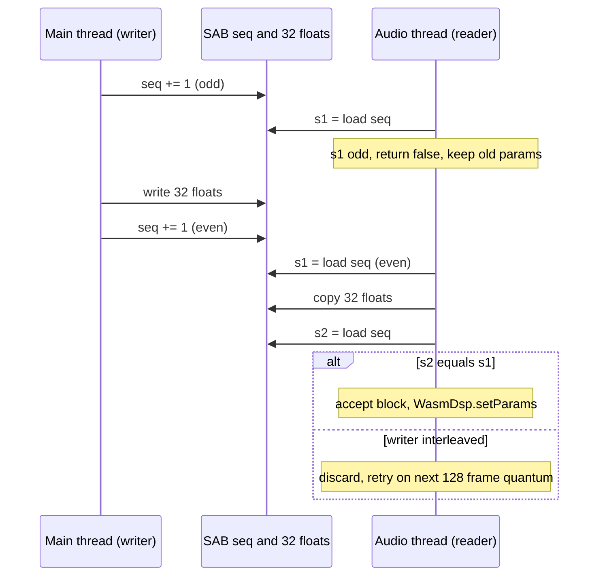
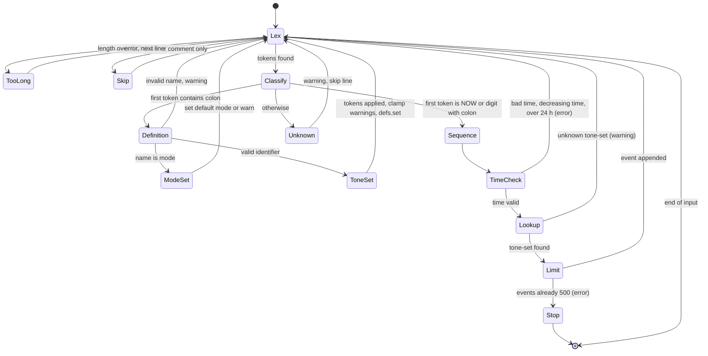
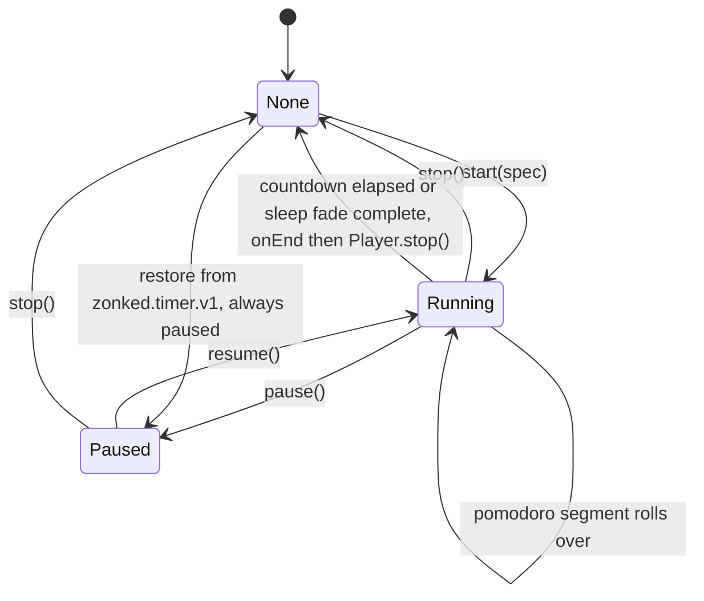
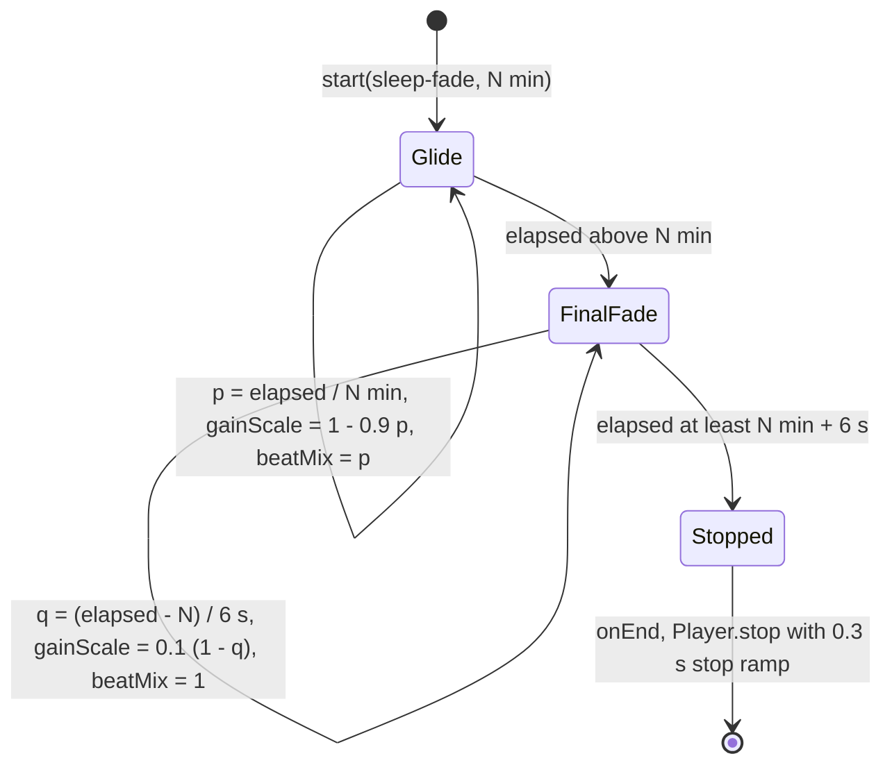
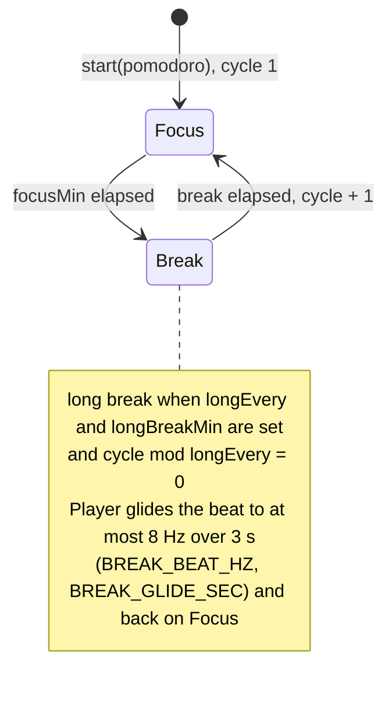

# Zonked: Low-Level Design

Every constant below was checked against the source on branch `feature/zonked-library`. Sections 1 to 14 describe the core, sections 15 to 23 the library (32 slot param block, layers, catalog, recommender, timers, shortcuts, mascot, bundle budget, threat model additions). File references are relative to the repository root.

## 1. WASM ABI and parameter block

Source: `crates/dsp-core/src/abi.rs`, `engine.rs`, `web/src/audio/dsp-wasm.ts`, `web/src/audio/params.ts`.

The module has no imports and exports its linear memory. A single static `Engine` is created lazily at 48,000 Hz if `zk_init` is never called.

| Export | Signature | Behavior |
|---|---|---|
| `zk_init` | `(sample_rate: f32)` | Builds a new `Engine`. Sample rate is sanitized to 8,000 to 192,000, default 48,000. Noise seeds are fixed. |
| `zk_param_block` | `() -> *mut f32` | Address of 32 `f32` slots (128 bytes) in linear memory. The host writes here. Slots 0 to 7 are the original ABI. |
| `zk_param_count` | `() -> u32` | Returns 32. A host that finds no such export treats the module as the 8 slot legacy ABI (`LEGACY_PARAM_COUNT`). |
| `zk_apply_params` | `()` | Copies the block, sanitizes each slot, sets targets. |
| `zk_render` | `(frames: u32)` | Clamps frames to 1..=128, fills the output buffers. |
| `zk_out_left`, `zk_out_right` | `() -> *const f32` | 128 `f32` each (512 bytes). |
| `zk_reset_phase` | `()` | Zeroes the four phase accumulators. Not called during playback. |

Parameter block, byte offset relative to the pointer returned by `zk_param_block()`:

| Slot | Offset | Name | Valid range | Sanitizer |
|---|---|---|---|---|
| 0 | 0 | `carrier_hz` | 20 to 1500 | `sanitize(.., CARRIER_MIN, CARRIER_MAX)` |
| 1 | 4 | `beat_hz` | 0.5 to 40 | `sanitize(.., BEAT_MIN, BEAT_MAX)` |
| 2 | 8 | `gain` | 0 to 0.85 | `sanitize(.., 0, GAIN_MAX)` |
| 3 | 12 | `mode` | 0 binaural, 1 monaural, 2 isochronic | `sanitize_enum(.., max 2)`, round to nearest |
| 4 | 16 | `noise_kind` | 0 off, 1 white, 2 pink, 3 brown | `sanitize_enum(.., max 3)` |
| 5 | 20 | `noise_level` | 0 to 1 | `sanitize(.., 0, 1)` |
| 6 | 24 | `ramp_seconds` | 0.05 to 30 | clamp, applied only if finite |
| 7 | 28 | reserved | ignored | none |

Slots 8 to 23 are the layers (section 15); 24 to 31 are reserved and written as 0. The block is 128 bytes in total. `sanitize(new, prev, lo, hi)` returns `clamp(new, lo, hi)` when `new.is_finite()` and `prev` otherwise, so NaN and infinity keep the last good value.

The JavaScript wrapper `WasmDsp.setParams` copies a block into these slots only when it differs from the last applied block, then calls `zk_apply_params`. After every `zk_render` it re-creates its typed-array views if `memory.buffer` changed (memory growth detaches old views).

## 2. Fixed-point phase

Source: `crates/dsp-core/src/phase.rs`, `engine.rs`.

A full turn is `2^64`. Each oscillator owns a `u64` accumulator. With `k = 2^64 / sr` computed once in `f64`:

```
inc(hz) = (hz as f64 * k) as u64        // saturating cast, truncates toward zero
phase   = phase.wrapping_add(inc)        // wrap is the turn boundary
```

The specification says "round"; the code truncates. The difference is below one unit, 2^-64 turn.

Four accumulators run per sample: `ph_l` at `carrier - beat/2`, `ph_r` at `carrier + beat/2`, `ph_c` at `carrier` (isochronic tone), `ph_b` at `beat` (isochronic gate). Ear frequencies are clamped to `[0.5, 0.45 * sr]`.

### 2.1 Worked example (sr = 48,000, carrier 200 Hz, beat 10 Hz)

```
k          = 2^64 / 48000                       = 384,307,168,202,282.3
f_L        = 200 - 10/2 = 195 Hz
f_R        = 200 + 10/2 = 205 Hz
inc(195)   = 74,939,897,799,445,056             = 0x010A_3D70_A3D7_0A40
inc(205)   = 78,782,969,481,467,872             = 0x0117_E4B1_7E4B_17E0
inc(200)   = 76,861,433,640,456,464             = 0x0111_1111_1111_1110
exact      = 2^64 / 240 = 76,861,433,640,456,465.07
```

After 240 samples (exactly one 200 Hz cycle at 48 kHz) the accumulator is `240 * 76,861,433,640,456,464 = 18,446,744,073,709,551,360 = 2^64 - 256`. The cycle closes 256 units short, which is `1.39e-17` turn. Over one second (200 cycles) the drift is `2.8e-15` turn, so frequency error is far below anything audible and phase never needs resetting. The wrap needs no branch because `wrapping_add` on `u64` is modular arithmetic.

Continuity: when a smoothed frequency changes, only `inc` changes. The accumulator keeps its value, so the waveform has no phase jump (tested in `phase_is_continuous_across_frequency_steps`).

### 2.2 Sine without libm

```
p        = (phase >> 32) as u32            // top 32 bits, resolution 2^-32 turn
quadrant = p >> 30                         // 0..3
x        = (p & 0x3FFF_FFFF) as f32 / 2^30 // position inside the quadrant, [0, 1)
if quadrant is odd:  x = 1 - x             // mirror about the peak
z        = x * x
s        = x * (C1 + z*(C3 + z*(C5 + z*C7)))   // approximates sin(pi/2 * x)
if quadrant >= 2:    s = -s
```

Coefficients: `C1 = 1.5707914`, `C3 = -0.6458931`, `C5 = 0.07943101`, `C7 = -0.004329256`. They define an odd 7th order polynomial fitted to `sin(pi x / 2)` on `[0, 1]`.

Error bound: the polynomial error, evaluated in `f64` against `sin(pi x / 2)` on 200,001 points, peaks at `8.2e-7`. Quantization of the quadrant position adds at most `(pi/2) * 2^-30 = 1.5e-9`, and `f32` rounding adds a few units of `6e-8`. The practical bound is therefore about `1e-6` (-120 dB). The unit test `sine_error_below_1e4` asserts the looser `1e-4`.

Spot check: phase `2^61` (one eighth turn) gives `p = 2^29`, quadrant 0, `x = 0.5`, `s = 0.70710746`, true value `0.70710678`, error `6.8e-7`.

`cos_turn(phase) = sin_turn(phase + 2^62)` (quarter turn offset).

### 2.3 Modes

| Mode | Left | Right |
|---|---|---|
| Binaural | `sin(ph_l)` | `sin(ph_r)` |
| Monaural | `0.5 * (sin(ph_l) + sin(ph_r))` | same value |
| Isochronic | `sin(ph_c) * gate` | same value, `gate = 0.5 - 0.5 * cos(ph_b)` |

The isochronic gate is a raised cosine in `[0, 1]` at the beat rate, so there are no hard on-off edges.

## 3. Smoothing

Source: `crates/dsp-core/src/smooth.rs`, `engine.rs::set_ramp`.

One-pole low-pass per sample: `y += a * (target - y)`, with

```
x = 1 / (tau * sr), clamped to [1e-9, 0.5]
a = x - x^2/2 + x^3/6 - x^4/24            // 4th order series of 1 - exp(-x)
```

`tau` is floored at `1e-4` s. No `exp` is needed in the audio path.

Time constants from `ramp_seconds` (R): gain and noise level use `tau = R`, carrier and beat use `tau = 2R`.

| Situation | R | tau gain | a gain at 48 kHz | tau frequency | a frequency at 48 kHz |
|---|---|---|---|---|---|
| Default (minimum) | 0.05 | 50 ms | `4.165799e-4` | 100 ms | `2.083116e-4` |
| Player tick (`TICK_RAMP_SEC`) | 0.25 | 250 ms | `8.3333e-5` approx | 500 ms | `4.1667e-5` approx |
| Start ramp (`START_RAMP_SEC`) | 2 | 2 s | `1.041661e-5` | 4 s | `5.208320e-6` |

The series differs from `1 - exp(-x)` by under `1e-13` at these `x`. A step reaches 63 percent of target after `tau` seconds and 95 percent after `3 tau`. Gain starts at 0, so no click occurs at start.

## 4. Noise

Source: `crates/dsp-core/src/noise.rs`.

### 4.1 Xoshiro256**

Seeds: `SEED_L = 0x5A4F_4E4B_4544_0001`, `SEED_R = ...0002` (the high bytes spell ZONKED). State is four `u64` initialized with four SplitMix64 outputs (`state += 0x9E3779B97F4A7C15`, then multiply-xorshift with `0xBF58476D1CE4E5B9` and `0x94D049BB133111EB`).

```
result = rotl(s1 * 5, 7) * 9
t  = s1 << 17
s2 ^= s0;  s3 ^= s1;  s1 ^= s2;  s0 ^= s3;  s2 ^= t;  s3 = rotl(s3, 45)
```

Uniform bipolar sample: `w = (next_u64() >> 40) as f32 * 2^-23 - 1`, which covers `[-1, 1)` with 24 bits of resolution. Left and right channels use independent generators, so the noise bed is decorrelated.

### 4.2 Colours (one sample of each per tick, same `w`)

| Colour | Formula | Output scale |
|---|---|---|
| White | `w` | `0.5 * w` |
| Pink (Paul Kellet, 3 poles) | `b0 = 0.99765*b0 + 0.0990460*w`, `b1 = 0.96300*b1 + 0.2965164*w`, `b2 = 0.57000*b2 + 1.0526913*w`, `p = b0 + b1 + b2 + 0.1848*w` | `0.17 * p` |
| Brown (leaky integrator) | `b = 0.998*b + 0.02*w` | `1.6 * b` |

Brown corner: pole 0.998 at 48 kHz gives `(1 - 0.998) * 48000 / (2 pi) = 15.3 Hz`, so the slope is about -6 dB per octave above that. Steady-state brown deviation: `0.02 * sqrt((1/3) / (1 - 0.998^2)) = 0.183`, times 1.6 is `0.292`. Tests check slopes with Goertzel bins (`noise_spectral_slopes`).

The three colours run in lockstep and are blended by smoothed weights `w[0..3]`. `noise_targets` sets exactly one weight to `noise_level` and the others to 0, so switching colour crossfades with the gain time constant instead of clicking.

Output per channel: `limit((tone + bed) * gain)` with `bed = white*w0 + pink*w1 + brown*w2`.

## 5. Limiter

Source: `crates/dsp-core/src/limiter.rs`.

```
if x is NaN:                      return 0
a = clamp(|x|, 0, 16)              // infinity becomes 16
y = a                              if a <= 0.8
y = 0.8 + 0.15 * t / (1 + t)       otherwise, t = (a - 0.8) / 0.15
y = clamp(y, 0, 0.95)              // the guarantee
return sign(x) * y
```

The knee is continuous with slope 1 at 0.8 and approaches 0.95 asymptotically. Examples: input 0.95 gives 0.875, 1.0 gives 0.8857, 1.7 gives 0.9286, 16 gives 0.9485. The final clamp guarantees `|y| <= 0.95` even after `f32` rounding. The Worklet repeats the bound in `copyOut` (`OUT_LIMIT = 0.95`, NaN becomes 0) as defense in depth.

## 6. Seqlock parameter protocol

Source: `web/src/audio/params.ts`.

SAB layout, 132 bytes (`PARAM_SAB_BYTES = 4 + 32*4`, was 36 with 8 slots):

| Byte offset | Type | Content |
|---|---|---|
| 0 | `Int32` | `seq`, odd while the writer is active |
| 4, 8, ..., 128 | 32 x `Float32` | param slots 0 to 31 (same order as sections 1 and 15) |

Writer (main thread, `ParamWriter.write`): `Atomics.add(seq, 1)` (now odd), copy 32 floats, `Atomics.add(seq, 1)` (now even). Reader (audio thread, `ParamReader.read`): load `seq` as `s1`; if odd return false; copy 32 floats into locals; load `seq` again; if it differs from `s1` return false; otherwise commit to the output block and return true. A failed read leaves the previous block in force. The reader never waits and never allocates, so the audio thread cannot be stalled by the UI thread. `Int32` wraparound preserves parity.



Fallback when `crossOriginIsolated` is false or `SharedArrayBuffer` is missing: `port.postMessage({ type: 'params', p: Float32Array(32) })`. The Worklet copies into a preallocated array and applies it at the next `process()`. Message types: `init { wasm, sab?, tele?, sampleRate }`, `params`, `stats-request { id }`. Replies: `ready`, `error { message }`, `stats { id, peak, rms, frames, nonZero }`.

`process()` flow in `worklet-core.ts`: read params (SAB first, else pending message), render in chunks of at most 128 frames, copy to outputs with the NaN and 0.95 guard, update peak, RMS and non-zero counters, then push telemetry.

## 7. Telemetry ring (SPSC)

Source: `web/src/audio/telemetry.ts`.

| Byte offset | Type | Content |
|---|---|---|
| 0 | `Int32` | write counter `w` (free-running) |
| 4 | `Int32` | read counter `r` (free-running) |
| 8 | `Float32[16384]` | `RING_FRAMES = 8192` interleaved L,R frames |

Total `8 + 8192*2*4 = 65,544` bytes. Slot for counter `c` is `(c & 8191) * 2` (left) and `+1` (right).

Index math:

- Occupancy: `(w - r) | 0` (int32 wrap-safe).
- Writer pushes every 4th frame (`DECIMATION = 4`) so at 48 kHz it produces 12,000 frames per second. If occupancy is already 8192 the frame is dropped and `dropped++`. It publishes `w` once per `process()` call with `Atomics.store`.
- At 12,000 frames per second the ring holds 0.683 s.
- Reader copies the newest `n = min(avail, out.length/2)` frames, where `start = (w - n) | 0`, then stores `r = w` (everything consumed). The oscilloscope asks for `FRAMES = 512`, about 42.7 ms of audio, once per animation frame.

Only the Worklet writes `w` and only the main thread writes `r`, which is what makes the ring safe without locks.

## 8. `.sbg` grammar and parser

Source: `web/src/sbg/lexer.ts`, `parser.ts`, `limits.ts`.

Limits: `maxBytes = 262144` (checked as UTF-8 length without allocating), `maxEvents = 500`, `maxLineLength = 512`, `maxTimeSec = 86400`, `maxDiagnostics = 1000`.

```ebnf
file        = { line } ;
line        = definition | sequence | comment | blank ;
comment     = "#" { any } ;                       (* also allowed after tokens *)
definition  = name ":" { token } ;
name        = "mode" | ident ;
ident       = ( letter | "_" ) , up to 31 of ( letter | digit | "_" | "-" ) ;
sequence    = time , ws , ident , [ "->" | ws "->" ] ;
time        = "NOW" | h ":" m [ ":" s ] ;         (* h,m,s: 1 or 2 digits, m,s <= 59 *)
token       = mode | noise | tone ;
mode        = "iso" | "isochronic" | "mono" | "monaural" | "bin" | "binaural" ;
noise       = ( "pink" | "white" | "brown" ) [ "/" number ] ;   (* percent, default 30 *)
tone        = [ carrier ] [ ( "+" | "@" ) beat ] [ "/" gain ] ; (* gain is a fraction *)
carrier     = number ;  beat = number ;  gain = number ;
number      = [ "+" | "-" ] digits(1-15) [ "." digits(1-15) ] ;
```

Notes: `mode:` is a definition whose single token sets the default mode for later tone-sets (`mode: bin`). Mode and noise words are case-insensitive. `NOW` is case-sensitive and means time 0. Defaults: carrier 200, beat 10, gain 0.5, noise level 0.3 when a bare noise name is given. A tone-set with only a noise token gets gain 0.

Clamps apply with a line-numbered warning: carrier 20 to 1500, beat 0.5 to 40, gain 0 to 0.85, noise 0 to 1 (percent divided by 100). Times must not decrease (error) and may not exceed 24 hours (error).

Per-line state machine:



`parseSbg` never throws: an internal exception becomes an error diagnostic. `ok` is true when no error-level diagnostic exists. Unknown tokens produce warnings and are skipped, so partially valid files still play when `ok` is true.

## 9. Sequencer interpolation

Source: `web/src/sbg/sequencer.ts`.

`eventIndexAt` is a binary search for the last event with `tSec <= t` (non-finite `t` is treated as 0). `voiceAt(events, t)`:

1. No events: `SILENT_VOICE` (gain 0).
2. Before the first event, or the current event has `ramp = false`, or there is no next event: hold the current voice.
3. Ramp: with `f = clamp((t - t0) / (t1 - t0), 0, 1)`, carrier, beat, noise level and gain are linearly interpolated and re-clamped to the safety bounds. Noise kind takes the current kind unless it is `off`, mode takes the current mode.

Example, `burnout-reset` preset: `alpha: 200+10/0.35 pink/15`, `theta: 200+6/0.35 pink/20`, lines `00:00:00 alpha ->` and `00:20:00 theta`. At t = 600 s, `f = 0.5`, beat = 8 Hz, noise level 0.175. The player samples this every `TICK_MS = 100` and the engine smooths it with `ramp = 0.25 s`.

Crew transitions (`Player.enterCrew`) are a second interpolation. If the state carries a valid `sbg` (parsed with the same parser), it plays as a script. Otherwise `blend(from, to, f)` interpolates carrier, beat and gain linearly over `transitionSec * 1000` ms, then holds. Mode and noise come from the target voice, which copies the current voice.

## 10. Bridge validation and SSE protocol

Source: `crew-bridge/src/validate.ts`, `server.ts`, `watch.ts`, `sbg.ts`.

Order of checks on each file change: size, JSON, `version`, `at`, `burnout`, `target`, `sbg`.

| Field | Rule | On violation |
|---|---|---|
| file size | at most 65,536 bytes (`MAX_STATE_BYTES`) | ignored, `/health.lastError` |
| `version` | exactly 1 | rejected |
| `at` | safe non-negative integer | rejected |
| `burnout.score` | rounded, clamped 0 to 100 | warning |
| `burnout.level` | focus, flow, recovery, decompress | rejected |
| `target.beatHz` | clamp 0.5 to 40 | warning |
| `target.carrierHz` | clamp 20 to 1500 | warning |
| `target.gain` | clamp 0 to 0.85, default 0.5 | warning |
| `target.transitionSec` | clamp 5 to 600, default 60 | warning |
| `target.presetId` | `^[a-z0-9][a-z0-9-]{0,31}$` | dropped, warning |
| `target.breathe` | boolean, else rejected | rejected |
| `sbg` | string or null, at most 4096 bytes, at most 20 timed lines, 512 chars per line, no control characters | null, warning |

The validator builds a fresh object and reads fields with `Object.hasOwn`, so unknown keys and `__proto__` are never copied. At most 20 warnings are kept. A rejected file never replaces the last good state.

Watching: `fs.watch` on the parent directory (atomic rename replaces the inode), 100 ms debounce, 2 s stat poll fallback, unchanged content is not re-broadcast, reads are capped without loading oversize files.

HTTP and SSE:

| Item | Value |
|---|---|
| Bind | `127.0.0.1`, default port 43210 |
| Host header | must equal `localhost:<port>` or `127.0.0.1:<port>`, else 403 |
| Origin header | if present must be in the allow-list (ports 5173, 4173, 8787 on localhost and 127.0.0.1, plus `--origin`), else 403 |
| Methods | GET, HEAD, OPTIONS (204 with `Access-Control-Max-Age: 600`), others 405 |
| Timeouts and caps | header and request timeout 10 s, 64 connections, 50 headers, 20 SSE clients (then 503), per-client backlog 256 KB |
| `GET /events` | `Content-Type: text/event-stream`, first frame `retry: 3000`, then the latest state if any, then one frame per accepted change |
| Frame format | `event: state\ndata: <json>\n\n` and every 15 s `event: ping\ndata: {"at":<epoch s>}\n\n` |
| `GET /state` | latest JSON, 404 `{"error":"no state yet"}` before the first |
| `GET /health` | `{ ok, hasState, lastError, warnings[], clients }`, plus `signals` when `--signals` is set |

Client side (`BridgeClient`): URL `http://localhost:43210/events`, ignores payloads over 70,000 bytes, `JSON.parse`, then `parseCrewState` re-validates and clamps (a second, independent check). On `error` it closes the source, reports `standalone`, and retries after `min(30000, 1000 * 2^min(attempt, 10))` ms. The browser CSP allows only `localhost:43210`, so the `127.0.0.1` host name is for non-browser clients.

## 11. Burnout score

Source: `.kiro/crew/agents/burnout-sentinel.md`.

```
velocity = min(commitsPerHour / 12, 1) * 30
duration = min(sessionMinutes / 240, 1) * 40
failures = min(buildFailures / 5, 1) * 20
sprawl   = min(dirtyFiles / 40, 1) * 10
score    = round(velocity + duration + failures + sprawl)       // 0..100
```

Inputs are capped: `sessionMinutes` 720, `buildFailures` 10, `dirtyFiles` 200. A 15 minute gap with no commits resets `sessionMinutes` to 0. Worked example: 7 commits per hour, 130 minutes, 1 failure, 12 dirty files gives `17.5 + 21.67 + 4 + 3 = 46.17`, score 46 (band `flow`). The agent file's sample JSON shows 54 for the same signals; the formula is authoritative.

Bands and targets (`crew.yaml`, `acoustic-sequencer.md`):

| Score | Level | Preset id | Beat | Carrier |
|---|---|---|---|---|
| 0 to 39 | focus | deep-focus | 40 Hz | 200 Hz |
| 40 to 59 | flow | flow-state | 18 Hz | 220 Hz |
| 60 to 79 | recovery | burnout-reset | 10 Hz | 200 Hz |
| 80 to 100 | decompress | burnout-reset | 6 Hz | 180 Hz |

Hysteresis: a band changes only after 2 consecutive readings beyond its edge. `transitionSec` is 60 for a one-band move and 120 for two or more, never from `focus` straight to `decompress`. At most 2 state writes per minute. A missing, stale (over 15 minutes) or degraded zero-score signals file produces no write, and the app keeps its current sound.

## 12. PWA caching and storage

| Item | Value |
|---|---|
| Strategy | `generateSW`, `registerType: 'autoUpdate'`, `injectRegister: false`, `registerSW({ immediate: true })` in `main.tsx` |
| Precache globs | `**/*.{html,js,css,wasm,svg,png,webmanifest,ico}` |
| Max cached file | 8 MiB |
| Navigation | `navigateFallback: 'index.html'`, `cleanupOutdatedCaches: true` |
| Manifest | `display: standalone`, theme and background `#0A0B0F`, icons 192, 512, maskable 512 |
| Cache headers | `/assets/*` immutable one year, `/index.html`, `/sw.js`, `/registerSW.js`, `/manifest.webmanifest` `no-cache` |
| IndexedDB | database `zonked` v1, stores `scripts` and `logs` (auto-increment `id`), name capped at 80 chars, in-memory fallback |
| localStorage | `zonked.safety.v1`, `zonked.reduceMotion`, `zonked.wakeLock` (`'1'` or `'0'`), `zonked.timer.v1` (timer state), wrapped so blocked storage never throws |

Build artifact sizes on this branch (from `web/dist/assets` after `npm run build`): WASM 38,564 bytes (8,631 before the layers), worklet 4,383 bytes, main bundle `index-*.js` 325,340 bytes raw and 99.60 KB gzip as printed by Vite (React 19 included), catalog chunk 36,432 bytes raw. Precache holds 36 entries (665.83 KiB). The first-load budget result is in section 22.

## 13. Threat model (STRIDE style)

| Threat | STRIDE | Vector | Mitigation | Residual risk |
|---|---|---|---|---|
| DNS rebinding to the bridge | Spoofing, Information disclosure | Attacker page resolves its domain to 127.0.0.1 and reads `/state` | Host allow-list (`localhost:<port>`, `127.0.0.1:<port>`) returns 403 otherwise. Origin allow-list. Read-only GET API. | State contents (score, targets) are low sensitivity. Any local process can still connect. |
| Malicious `.sbg` file | Tampering, Denial of service | Oversize, huge event count, long lines, ReDoS, values beyond hearing bounds | 256 KB, 500 events, 512 chars, anchored linear regexes, never executed, clamp with warnings, three clamp layers | Loud-but-bounded content is still possible within 0.85 gain. User controls headphone volume. |
| Hostile state file | Tampering, Elevation | Another local process or a prompt-injected agent writes `.zonked-state.json` | 64 KB cap, strict schema, fresh object (no prototype pollution), `sbg` limits, client re-validation, agents told text is data, bridge never executes anything | A same-user process can still steer the sound within bounds. |
| CSP and COEP bypass or breakage | Tampering, Denial of service | Injected script, third-party embed, missing isolation | `script-src 'self' 'wasm-unsafe-eval'`, no inline scripts, `object-src 'none'`, `frame-ancestors 'none'`, COOP same-origin, COEP require-corp, static audit on every build | `style-src 'unsafe-inline'` is allowed for React style props (project decision), so CSS injection is not blocked. Without isolation the app falls back to `postMessage`. |
| Supply chain | Tampering | Malicious npm or cargo package | Bridge has zero runtime dependencies, dsp-core has zero crates, lockfiles committed, no remote scripts or CDNs, `legacy/` never imported | Dev-time tooling (Vite, TypeScript, Playwright, the host CLI, pptxgenjs) is trusted at build time. |
| Hearing safety | Harm | Extreme frequency, gain, NaN, step changes | Carrier 20 to 1500, beat 0.5 to 40, gain at most 0.85, limiter at 0.95, 2 s start ramp, 0.3 s stop ramp, smoothing, safety gate with headphone and not-a-medical-device notice | Sustained listening at high system volume is the user's choice. Not a medical device. |
| Photosensitivity | Harm | Fast flashing mascot or pacer | `visibleHz` caps at 3 Hz, Reduce motion option and `prefers-reduced-motion`, pacer flips every few seconds | Not clinically validated. |
| Service worker staleness | Tampering | Old cached build keeps a vulnerable asset | `autoUpdate`, `no-cache` on `sw.js`, `cleanupOutdatedCaches` | Offline users see the last cached version until they reconnect. |
| Bridge resource exhaustion | Denial of service | Many clients or slow readers | 20 SSE clients, 4 per Origin, `/events` GET only, 64 connections, backlog drop, timeouts | A local process can still occupy the port first. |
| Unauthenticated loopback bridge | Spoofing, Tampering | A local process binds `localhost:43210` before the bridge, or writes the state file; the web client trusts it | Accepted trust model: no token. Every value is clamped (three layers), gain and frequency are smoothed in the engine, no autoplay (safety gate), state file opened with `O_NOFOLLOW`. See crew-bridge/README.md | A same-user process can steer sound and the displayed score within hard bounds. |
| Agent-triggered local code | Elevation | `cargo test` runs tests, `build.rs` and proc macros from `crates/dsp-core` on file edit | `scripts/check-no-buildrs.mjs` runs first in the hook and in the verifier and fails on `build.rs` or proc-macro deps. Exact `shell_allow` entries, scoped `write_allow` per agent | Test code in dsp-core still runs locally. Review pulled branches first. |
| Eval and injection in UI | Elevation | `innerHTML`, `eval` | Audit rejects them. The only DOM parsing is the bundled `logo.svg` through `DOMParser`. | None known. |

## 14. Verification map

| Area | Command |
|---|---|
| DSP | `cargo test --manifest-path crates/dsp-core/Cargo.toml`, `cargo clippy ... -- -D warnings` |
| Bridge | `npm --prefix crew-bridge test` |
| Web | `npm --prefix web test`, `npm --prefix web run audit:security`, `npm --prefix web run verify:e2e`, `npm --prefix web run check:bundle` (after `npm --prefix web run build`) |
| Docs and deck | `npm --prefix docs run build:deck` |
| Crew verifier | `dsp-verifier` writes `.zonked-verify.json` after every DSP change |

## 15. Parameter block, 32 slots (contract C1 of the library)

Source: `web/src/audio/params.ts` (`SLOT`, `voiceToParams`), `crates/dsp-core/src/layers/mod.rs` (`Layers::apply`), `engine.rs` (`PARAM_SLOTS = 32`).

Byte offset is `4 * slot` from the pointer returned by `zk_param_block()`. In the SharedArrayBuffer the same floats start at byte `4 + 4 * slot` (byte 0 is the seqlock counter).

| Slot | Offset | Name | Valid range | Sanitizer in dsp-core | Default before any write |
|---|---|---|---|---|---|
| 0 | 0 | `carrier_hz` | 20 to 1500 | `sanitize` | engine default |
| 1 | 4 | `beat_hz` | 0.5 to 40 | `sanitize` | engine default |
| 2 | 8 | `gain` | 0 to 0.85 | `sanitize` | 0 |
| 3 | 12 | `mode` | 0 bin, 1 mono, 2 iso | `sanitize_enum`, max 2 | 0 |
| 4 | 16 | `noise_kind` | 0 off, 1 white, 2 pink, 3 brown | `sanitize_enum`, max 3 | 0 |
| 5 | 20 | `noise_level` | 0 to 1 | `sanitize` | 0 |
| 6 | 24 | `ramp_seconds` | 0.05 to 30 | clamp | 0.05 |
| 7 | 28 | reserved | ignored | none | 0 |
| 8 | 32 | `lofi_level` | 0 to 1 | `sanitize(.., 0, 1)` | 0 |
| 9 | 36 | `lofi_warmth` | 0 to 1 (high is darker) | `sanitize(.., 0, 1)` | 0.5 |
| 10 | 40 | `crackle` | 0 to 1 | `sanitize(.., 0, 1)` | 0 |
| 11 | 44 | `inst_level` | 0 to 1 | `sanitize(.., 0, 1)` | 0 |
| 12 | 48 | `inst_kind` | 0 pluck, 1 drone, 2 fm bell-pluck | `sanitize_enum`, max 2 | 0 |
| 13 | 52 | `inst_root_hz` | 55 to 880 | `sanitize` | 220 |
| 14 | 56 | `inst_scale` | 0 to 7 | `sanitize_enum`, max 7 | 0 |
| 15 | 60 | `inst_bpm` | 30 to 180 | `sanitize` | 60 |
| 16 | 64 | `pad_level` | 0 to 1 | `sanitize(.., 0, 1)` | 0 |
| 17 | 68 | `pad_chord` | 0 to 7 | `sanitize_enum`, max 7 | 0 |
| 18 | 72 | `pad_root_hz` | 55 to 440 | `sanitize` | 110 |
| 19 | 76 | `chime_level` | 0 to 1 | `sanitize(.., 0, 1)` | 0 |
| 20 | 80 | `chime_rate_per_min` | 1 to 30 | `sanitize` | 6 |
| 21 | 84 | `perc_level` | 0 to 1 | `sanitize(.., 0, 1)` | 0 |
| 22 | 88 | `perc_bpm` | 30 to 180 | `sanitize` | 70 |
| 23 | 92 | `perc_pattern` | 0 to 7 | `sanitize_enum`, max 7 | 0 |
| 24 to 31 | 96 to 124 | reserved | 0 | none | 0 |

`Layers::apply` reads slot `8 + i` with `p.get(..)`, so a block shorter than 24 slots yields NaN for the missing entries and each missing entry keeps its previous value. The last column is the value `Layers::new` holds before any write. All levels start at 0, so a legacy host that writes only slots 0 to 7 gets the pre-layer output bit for bit. `sanitize_enum(x, prev, max)` rounds with `(clamp(x, 0, max) + 0.5) as u8`.

The host side (`voiceToParams`) clamps a second time with `clampLayers` (`LAYER_BOUNDS`: level 0 to 1, `instRootHz` 55 to 880, `padRootHz` 55 to 440, bpm 30 to 180, chime rate 1 to 30, enums 0 to 7, rounded), writes slots 24 to 31 as 0, and `WasmDsp` writes only `min(zk_param_count(), 32)` slots.

## 16. Layer algorithms

Source: `crates/dsp-core/src/layers/`. All numbers are read from the code. `sr` is the sample rate (48,000 Hz in the examples). `a(tau) = coefficient(tau, sr)` is the one-pole coefficient from section 3, and `decay(tau, rate) = 1 - a(tau at rate)` is the per-step multiplier of an exponential decay with time constant `tau`.

### 16.1 Shared pieces (`util.rs`)

| Piece | Definition |
|---|---|
| `SEMI` | Table of `2^(i/12)` for i = 0 to 24 (1.0, 1.0594631, ..., 2.0 at 12, 4.0 at 24). `semi_ratio` returns 4.0 beyond the table. No `powf`. |
| `Rng` | Wrapper on `Xoshiro256` (section 4). `unit()` = `(next_u64() >> 40) / 2^24` in `[0, 1)`. `index8()` = `next_u64() >> 61` in 0..7. `bipolar()` in `[-1, 1)`. |
| `lp_coef(fc, sr)` | `x = clamp(2 pi fc / sr, 1e-5, 2)`, `a = x / (1 + x)`. At 48 kHz: 3,500 Hz gives 0.3142, 1,850 Hz gives 0.1950, 200 Hz gives 0.02551, 1,500 Hz gives 0.1641, 6,000 Hz gives 0.4399. |
| `Env` | Soft attack then exponential decay. While attacking `v += a_att (1 - v)`; at `v > 0.98` it switches to `v = flush(v * d)`. `a_att` is `coefficient(0.003, sr)` (0.006920) or `coefficient(0.004, sr)` (0.005195). |
| `Clock` | Sample countdown held in `f64`. `tick(next_len)` subtracts 1 and, when `left <= 0`, adds `next_len` and fires. Starts at 1.0, so the first event fires on the first sample. The fractional carry keeps tempo drift negligible. |
| `tape(x)` | `c = clamp(x, -1, 1)`, `c (1.5 - 0.5 c^2)`. Monotone, bounded to +-1. |
| `flush(x)` | Values under `1e-20` become exact 0, so decays never reach subnormals. |

Every layer is processed on every sample whatever its level, so cost is constant. Seeds (the high bytes spell the layer name):

| Layer | Seed |
|---|---|
| lofi | `0x4C4F_4649_0000_0001` ("LOFI") |
| instrument | `0x494E_5354_0000_0001` ("INST") |
| chimes | `0x4348_494D_0000_0001` ("CHIM") |
| percussion | `0x5045_5243_0000_0001` ("PERC") |

The pad uses no random stream (fixed tables and LFOs).

### 16.2 Mix budget and bus (`mod.rs`)

```
lvl[i]     = step(lvl[i], target[i], a_lvl)        a_lvl = coefficient(0.02, sr) = 1.0411e-3 at 48 kHz
bus        = sum_i out[i] * lvl[i] * BUDGET[i]    BUDGET = [0.25, 0.25, 0.25, 0.15, 0.25]  (lofi, instrument, pad, chimes, percussion)
bus        = soft(bus)
tone_scale = 1 - 0.6 * clamp(sum_i lvl[i] * 0.5, 0, 1)
pre        = ((tone + bed) * tone_scale + bus) * gain
out        = limit(pre)
```

`soft(x)` is the identity for `|x| <= 0.45` and `0.45 + 0.15 t / (1 + t)` with `t = (|x| - 0.45) / 0.15` above it, so the bus never exceeds 0.6 (raw maximum 1.15 maps to 0.5735, 2.0 maps to 0.5868). `tone_scale` is 1.0 at level sum 0, 0.875 at 0.5, 0.75 at 1, and 0.5 at 2 or more. The worst case before the limiter is 1.1 (tests record the pre-limiter peak through `take_peak`), times the 0.85 gain cap is 0.935, which the limiter maps to 0.871. The guarantee `|y| <= 0.95` is unchanged.

### 16.3 Lofi (`lofi.rs`)

- Four sine oscillators at `110 * [1, 1.4983, 2, 2.5198] * [1, 1.0035, 0.9965, 1.0052]` Hz, start phases `0, 2^60, 2^61, 3*2^60`. Each adds a second harmonic at 0.35: `s = sum(sin(p) + 0.35 sin(2p))`.
- Warmth is smoothed with `coefficient(0.05, sr)` and sets the low-pass cutoff `fc = 3500 - 3300 * warmth` Hz through `lp_coef(fc, sr)`.
- `lp += a (s / 4.2 - lp)`, `bed = tape(lp * 1.8)`.
- Crackle: each sample `hit = unit() < crackle * 25 / sr` (up to 25 pops per second). A pop sets `pop = bipolar() * 0.6`; `pop` is multiplied by 0.8 per sample and smoothed by a one-pole of coefficient 0.5.
- Output `clamp(bed * 0.8 + pop_lp * 0.5, -1, 1)`.

### 16.4 Instrument (`instrument.rs`)

- Tempo: one note per beat, `step_len = sr * 60 / bpm` samples (96,000 at 30 BPM, 41,143 at 70, 16,000 at 180 at 48 kHz).
- Pitch: `degree = index8()`, `semis = SCALES[scale][degree]`, `hz = min(root * semi_ratio(semis), 0.2 sr)`. Four voices rotate round-robin.
- Scale tables (semitones, 8 degrees): 0 major-pentatonic `[0,2,4,7,9,12,14,16]`, 1 minor-pentatonic `[0,3,5,7,10,12,15,17]`, 2 dorian `[0,2,3,5,7,9,10,12]`, 3 aeolian `[0,2,3,5,7,8,10,12]`, 4 lydian `[0,2,4,6,7,9,11,12]`, 5 whole-tone `[0,2,4,6,8,10,12,14]`, 6 hirajoshi `[0,2,3,7,8,12,14,15]`, 7 drone-fifths `[0,7,12,19,7,12,0,19]`.
- Kind 0, pluck (Karplus-Strong): a 2048 sample circular line per voice. `d = clamp(sr / hz - 0.5, 4, 2044)`, `n = floor(d)`, `frac = d - n`, all-pass coefficient `c = (1 - frac) / (1 + frac)`, loop gain `g = decay(2.5, hz)` (0.99637 at 110 Hz, 0.998183 at 220 Hz, 0.999091 at 440 Hz; a 2.5 s time constant counted in loop passes). Each pass: `avg = 0.5 (tap[n] + tap[n+1]) g`, then `y = c (avg - y_prev) + x_prev`. Excitation runs in the loop for `n` samples: noise through a one-pole of coefficient 0.4, blended with `m += 0.2 (target - m)` and written as `y (1 - m) + 0.9 * noise_lp * m`. There is no O(N) fill. The lowest pitch the line holds is `sr / 2048` = 23.4 Hz at 48 kHz, below the 55 Hz minimum root.
- Kind 2, FM bell-pluck: carrier at `hz`, modulator at `min(3.5 hz, 0.45 sr)`, index starts at 2.5 and decays with `decay(0.35, sr)` (0.999940). Amplitude `Env` with `a_att = coefficient(0.003, sr)` and decay `decay(1.2, sr)` (0.999983). Output `sin(pc + idx * sin(pm))` in phase units via `rad_units`.
- Kind 1, drone: three sines at `f * [1, 1.5, 2]` with amplitudes `[0.5, 0.25, 0.2]`. `f` glides toward `0.5 * hz` (floor 27.5 Hz) with `coefficient(0.6, sr)` (3.47e-5); the target changes on every fourth note (`beats & 3 == 0`). A 0.1 Hz LFO gives `swell = 0.8 + 0.2 sin`.
- Kind crossfade: one-hot weights smoothed with `coefficient(0.03, sr)` (6.94e-4). Output `clamp(pluck_sum * 0.6 * w0 + drone * swell * w1 + fm_sum * 0.5 * w2, -1, 1)`. All three kinds run every sample.
- `events` counts triggers; tests read it with `Engine::event_counts()`.

### 16.5 Pad (`pad.rs`)

- Four oscillators. Chord table (semitones): 0 maj7 `[0,4,7,11]`, 1 min7 `[0,3,7,10]`, 2 sus2 `[0,2,7,12]`, 3 sus4 `[0,5,7,12]`, 4 add9 `[0,4,7,14]`, 5 min9 `[0,3,7,14]`, 6 maj-open `[0,7,16,19]`, 7 fifths `[0,7,12,19]`.
- Frequency target `root * semi_ratio(offset) * DETUNE[i]`, `DETUNE = [1.0, 1.0042, 0.9962, 1.0075]`. Frequency glides with `coefficient(0.3, sr)` (6.94e-5), so a chord or root change does not click.
- Swell: four phase LFOs at 0.050, 0.071, 0.093 and 0.113 Hz with start phases `0, 2^62, 2^63, 3*2^62`; `amp = 0.65 + 0.35 sin(lfo)`.
- Voice sample `amp * (0.85 sin(p) + 0.1 sin(2p))`; the sum is multiplied by 0.25.

### 16.6 Chimes (`chime.rs`)

- Six inharmonic partials, ratios `[1, 2.76, 5.4, 8.93, 13.34, 18.64]`, amplitudes `[0.40, 0.25, 0.16, 0.10, 0.07, 0.05]`, decay time constants `[3.0, 2.2, 1.6, 1.1, 0.8, 0.5]` s (per-sample multipliers 0.9999931 down to 0.9999583 at 48 kHz). Attack `coefficient(0.004, sr)`.
- Scheduling: mean interval `sr * 60 / rate` samples (2,880,000 at 1 per minute, 480,000 at 6, 96,000 at 30), each multiplied by `0.6 + 0.8 * unit()`, so spacing runs from 60 to 140 percent of the mean.
- Pitch: `i = floor(unit() * 10)` into the pentatonic table `[0,2,4,7,9,12,14,16,19,21]` on a 392 Hz base. Partials with `f >= 0.45 sr` are muted.

### 16.7 Percussion (`perc.rs`)

- Step length `sr * 60 / bpm / 4` samples (a 16th note, 16 steps per bar of four beats), index modulo 16.
- Patterns as `(thump, snare)` amounts per step:

| Id | Name | Steps |
|---|---|---|
| 0 | soft-pulse | thump 0.6 on steps 0, 4, 8, 12 |
| 1 | heartbeat | thump 0.8 on 0 and 8, thump 0.5 on 3 and 11 |
| 2 | backbeat | thump 0.8 on 0 and 8, snare 0.7 on 4 and 12 |
| 3 | brush-shuffle | snare 0.25 on 0 and 8, 0.2 on 2, 6, 10, 14, 0.5 on 4 and 12 |
| 4 | rim-click | thump 0.5 on 0, snare 0.4 on 3, 7, 11, 15 |
| 5 | sparse-snare | thump 0.6 on 0, snare 0.8 on 12 |
| 6 | double-time | thump 0.7 on 0, 4, 8, 12, snare 0.3 on 2 and 10, 0.5 on 6 and 14 |
| 7 | half-time | thump 0.8 on 0, snare 0.8 on 8 |

- Thump: sine at `52 + 90 * sweep` Hz (142 Hz falling to 52 Hz), `sweep` multiplied by `decay(0.025, sr)` (0.999167) per sample. Envelope attack `coefficient(0.003, sr)`, decay `decay(0.12, sr)` (0.999826).
- Snare: noise through a low-pass `lp_coef(6000)` and a high-pass formed as `lp - one-pole(lp_coef(1500))`, a band of about 1.5 to 6 kHz, plus a 185 Hz sine body. Decay `decay(0.09, sr)` (0.999769). Level `env * snare_amp * (1.6 * band + 0.4 * sin(185 Hz))`.
- Output `clamp(0.9 * kick + 0.8 * snare, -1, 1)`.

### 16.8 Determinism and tests

The same parameter block and sample rate always renders the same samples: seeds are constants, there is no wall clock, and the only state is the arrays above. Rust tests cover bit-identical output with all levels 0 (recorded hashes), `|y| <= 0.95` at maximum levels, click-free level changes, scheduled event counts, and NaN and infinity in the new slots.

## 17. Catalog DSL and archetype counts

Source: `web/src/catalog/dsl.ts`, `build.ts`, `seeds.ts`, `archetypes/*.ts`, `events.ts`, `registry.ts`. Pure TypeScript, no DOM, no randomness, no clock.

### 17.1 Grammar

```ebnf
catalog    = seeds , categories ;
seeds      = 21 android seed , 3 gnaural seed ;    (* segments [sec, beatStart, beatEnd] *)
categories = VIBES , HEALING , LUCID_DREAMS , MEDITATION , SLEEP , ADHD_CONTROL , FOCUS , WORK_RECOVERY ;
category   = prefix , adjectives(12) , nouns(12) , archetype { archetype } ;
archetype  = slug , shape , from , to , [ ret ] , mins[] , carriers[] , modes[] , noises[] , layers[][] ,
             vibes[] , situations[] , intensity(1..5) , gain , count , tags[] , reason , jitter , [ breath ] ;
shape      = "plateau" | "ramp-down" | "ramp-up" | "wave" | "ladder" ;
layer name = "lofi" | "crackle" | "drone" | "pluck" | "bell" | "pad" | "chimes" | "perc" ;
```

`arch()` fills defaults: modes `['binaural']`, noises `[['off', 0]]`, layers `[[]]`, intensity 2, gain 0.45, jitter 0.3, no tags. `at(xs, i)` is a wrap-around index.

Variant `i` (0-based) of an archetype, with category-wide running index `j`:

| Field | Formula |
|---|---|
| id | `${prefix}-${slug}-${pad2(i + 1)}` |
| minutes `m` | `at(mins, i)` |
| carrier | `at(carriers, i * 3 + 1)` |
| mode | `at(modes, i + (i >> 2))` |
| noise | `at(noises, i >> 1)` |
| layer set | `at(layers, i * 2 + (i >> 1))`, each name expanded by `PRESETS[name](i)` and merged left to right |
| vibe | `at(vibes, i)` |
| target beat | `clamp(to + ((i % 3) - 1) * jitter, 0.5, 40)` |
| name | `p = (j * 7) mod 144`, `at(adjectives, p) + " " + at(nouns, floor(p / 12))` |
| tags | `[slug, band, mode, ...tags]`; band from `to`: under 4 delta, under 8 theta, under 12 alpha, under 30 beta, else gamma |

Since 7 and 144 are coprime, names inside a category never repeat. All 232 names are unique (checked by running the generator).

Layer presets (`PRESETS`, variant `v`): lofi `{lofiLevel 0.45, lofiWarmth at([0.5,0.6,0.7], v)}`; crackle `{crackle 0.12}`; drone `{instLevel 0.35, instKind 1, instRootHz at([55,62,73,82], v), instScale 7, instBpm 40}`; pluck `{instLevel 0.3, instKind 0, instRootHz at([196,220,247,262], v), instScale at([0,2,4,1], v), instBpm at([48,56,64,72], v)}`; bell `{instLevel 0.28, instKind 2, instRootHz at([262,294,330,349], v), instScale 4, instBpm 40}`; pad `{padLevel 0.4, padChord at([0,2,4,6], v), padRootHz at([110,98,123,87], v)}`; chimes `{chimeLevel 0.25, chimeRatePerMin at([3,4,6,8], v)}`; perc `{percLevel 0.2, percBpm at([64,72,80,92], v), percPattern at([0,3,4,7], v)}`.

Stage contours (`contour(shape, m, a, b, ret)`, with `r = min(5, max(1, 0.15 m))` minutes):

| Shape | Points (minutes, beat, ramp flag) |
|---|---|
| plateau | `(0, a, ramp)`, `(r, b, ramp only if ret)`; with `ret` also `(m - r, b, ramp)`, `(m, ret, no ramp)` |
| ramp-down, ramp-up | `(0, a, ramp)`, `(0.7 m, b, no ramp)` |
| wave | 7 points at `m k / 6`, beat `a` for even k and `b` for odd k, ramp for k below 6 |
| ladder | 4 steps of length `m / 4`, beat `a + (b - a) k / 3`; steps 0 to 2 hold then ramp at 75 percent of the step, step 3 holds |

`deriveLayerTags` builds `layerTags` from the stages actually used. `isAdhdFriendly` requires intensity 3 or less, consecutive beat jumps of 4 Hz or less, every stage isochronic or with a beat from 12 to 20 Hz, no crackle, and percussion at or below 100 BPM.

`templateToEvents(t)` converts at most 499 stages to `SbgEvent[]` with times `clamp(max(prev, atMin * 60), 0, 86400)` (never decreasing), every carrier, beat, gain and noise level clamped to `BOUNDS`, layers merged over `NO_LAYERS` and clamped to `LAYER_BOUNDS`, plus a closing event at `max(prev, recommendedMinutes * 60)` that holds the last stage with `ramp = false`.

### 17.2 Counts (computed by running the generator)

Method: a throwaway script in the scratch directory bundled `web/src/catalog/build.ts` with `web/node_modules/.bin/esbuild` and ran it with Node. The numbers satisfy `catalog.test.ts` (at least 210 templates, at least 15 per category, 21 Android and 3 Gnaural seeds, unique ids).

| Category | Prefix | Archetypes | Generated | Seeds | Total |
|---|---|---|---|---|---|
| vibes | `vibe` | 6 | 26 | 2 | 28 |
| healing | `healing` | 6 | 26 | 3 | 29 |
| lucid-dreams | `lucid` | 5 | 26 | 4 | 30 |
| meditation | `meditation` | 6 | 26 | 6 | 32 |
| sleep | `sleep` | 6 | 26 | 3 | 29 |
| adhd-control | `adhd` | 6 | 26 | 1 | 27 |
| focus | `focus` | 6 | 26 | 4 | 30 |
| work-recovery | `recovery` | 6 | 26 | 1 | 27 |
| total | | 47 | 208 | 24 | 232 |

Archetypes (slug, shape, variants):

- vibes: lofi-study plateau 6, warm-glow plateau 4, bright-air plateau 4, ether-float wave 4, minimal-hum plateau 4, spark-groove plateau 4.
- healing: tension-release ramp-down 5, restore-theta plateau 5, heart-calm plateau 4, ache-ease wave 4, soothe-glide ramp-down 4, sunrise-lift ramp-up 4.
- lucid-dreams: wbtb-theta plateau 6, rem-ladder ladder 5, aware-wave wave 5, dream-drift ramp-down 5, astral-calm plateau 5.
- meditation: alpha-sit plateau 5, theta-descent ramp-down 5, schumann-hold plateau 4, breath-pacer plateau 4, bell-silence plateau 4, delta-glide ramp-down 4.
- sleep: onset-delta ramp-down 6, drift-theta ramp-down 5, deep-delta plateau 5, nap-reset plateau 4, breath-down ramp-down 3, rain-bed plateau 3.
- adhd-control: smr-steady plateau 5, beta-anchor plateau 5, cadence-pulse plateau 4, quiet-bed plateau 4, start-ramp ramp-up 4, sprint-steps ladder 4.
- focus: alpha-beta plateau 5, deep-beta plateau 5, gamma-edge ramp-up 4, flow-ramp ramp-up 4, reading-calm plateau 4, sprint-pulse ladder 4.
- work-recovery: screen-down ramp-down 5, micro-break plateau 4, post-sprint ramp-down 4, eye-rest plateau 4, lofi-unwind plateau 5, commute-decompress ramp-down 4.

Across all 232: ADHD friendly 64; layer tags binaural 95, monaural 71, isochronic 66, noise 184, lofi 36, instrument 74, pad 71, chimes 34, percussion 16. Recommended duration runs from 5 to 180 minutes. Sources: 208 `original`, 21 `android`, 3 `gnaural`. The seeds re-express published numbers only (beat frequencies, durations, noise use); no code or text from the GPLv3 reference is copied.

`TEMPLATES` is a lazy `Proxy` over `getTemplates()`. The catalog is built on first access and memoized, never at import time.

## 18. Recommender scoring

Source: `web/src/catalog/recommend.ts`. Pure and deterministic: no clock, no randomness, no storage. Input `RecContext { situation, vibe?, availableMinutes, timeOfDay, sensorySensitivity, deviceType }`.

| Term | Rule | Points |
|---|---|---|
| Situation | template lists the situation | +40, otherwise 0 |
| Vibe | none chosen | +7 flat |
| | equals template vibe | +15 |
| | differs | 0 |
| Duration (`rec` template minutes, `a = max(1, availableMinutes)`) | `rec <= a` | `15 * (0.6 + 0.4 * rec / a)`, 9 to 15 |
| | `rec > a`, `over = (rec - a) / a` | `max(0, 15 * (1 - 1.5 * over))`, minus 5 if `over > 0.5` |
| Time of day | `TOD[category][period] * 10` | 0 to 10 |
| Night penalty | `intensity >= 4` at night | -5 |
| Device, speaker | no binaural stage | +10 |
| | has a binaural stage | -8, with a "Warning: binaural beats need headphones" reason |
| Device, headphones or bluetooth | binaural template | +10 |
| | other template | +8 |
| Sensitivity, low | any | +10 |
| Sensitivity, medium | intensity 3 or less, flagged | +7 |
| | intensity 3 or less, not flagged | +10 |
| | intensity above 3 | +4 |
| Sensitivity, high | not flagged, intensity 2 or less | +10 |
| | not flagged, intensity 3 | +7 |
| | flagged | 0, excluded in tiers 1 and 2 |

Flagged means `intensity > 3`, any percussion stage, or any crackle stage. The flag only excludes under high sensitivity. Final `score = max(0, round to 0.1)`. Maximum is 100 (40 + 15 + 15 + 10 + 10 + 10). Ties break by ascending id.

Time of day table `TOD`:

| Category | Morning | Afternoon | Evening | Night |
|---|---|---|---|---|
| focus | 1 | 1 | 0.5 | 0.1 |
| adhd-control | 1 | 1 | 0.5 | 0.1 |
| vibes | 0.5 | 0.8 | 1 | 0.5 |
| work-recovery | 0.5 | 1 | 1 | 0.4 |
| healing | 0.6 | 0.7 | 1 | 0.8 |
| meditation | 1 | 0.6 | 1 | 0.6 |
| sleep | 0 | 0.2 | 0.7 | 1 |
| lucid-dreams | 0 | 0.1 | 0.6 | 1 |

`timeOfDayFor`: hours 05 to 11 morning, 12 to 16 afternoon, 17 to 21 evening, otherwise night. The default context is `deep-work`, 30 minutes, medium sensitivity, headphones.

Tiers guarantee at least `limit` (default 5) results: tier 1 is situation matches that are not flagged under high sensitivity (the flag is only set under high), tier 2 drops the situation requirement, tier 3 is everything. The first tier with enough entries wins. Picks that do not match the situation then carry the reason "Filters relaxed: too few exact matches, so close alternatives are included." Every recommendation carries the template's `reasonTemplate` (`{minutes}` replaced) plus one reason per term.

Computed example (headphones, 30 minutes, evening, medium sensitivity): `adhd-focus` gives android-adhd-cycle 87, focus-flow-ramp-01 87, focus-alpha-beta-01 86; `cant-sleep` gives sleep-onset-delta-01 89, lucid-dream-drift-01 88; `meditate` gives meditation-alpha-sit-04 92; `quick-reset` gives healing-sunrise-lift-03 92.

Device detection (`ui/device.ts`) classifies the default `audiooutput` label with regular expressions (Bluetooth, headphones, speaker). It is read only and never requests a permission, so labels are often empty and the result is `unknown`.

## 19. Timers

Source: `web/src/app/timers.ts`, `player.ts`, `ui/recContext.ts`. `TimerController` takes an injected `Clock` (`now`, `setInterval`, `clearInterval`) and optional storage, so tests drive it with a fake clock. Constants: `TIMER_STORAGE_KEY = 'zonked.timer.v1'`, `SLEEP_TARGET_BEAT_HZ = 2.5`, `SLEEP_FLOOR_SCALE = 0.1`, `FINAL_FADE_SEC = 6`, defaults countdown 30, sleep 30, focus 25, break 5 minutes, minutes clamped to 1..720, poll 500 ms (`POLL_MS`).

Elapsed time accumulates from clock deltas (`elapsedMs += max(0, now - lastMs)`), not from poll counts, so a throttled background tab loses no time. The poll notifies listeners only when the visible key (`kind|running|remainingSec|phase|cycle|finalFade`) changes.

### 19.1 Controller state machine



`cycleNext()` steps none, countdown, sleep-fade, pomodoro, none. `Player.startTimer` pauses the timer at once when the player is not playing, and `onEnd` calls `Player.stop`. `seekBy(delta)` moves inside the current segment and clamps to `[0, total - 1 ms]`.

### 19.2 Sleep fade



The Player applies `beat = v.beat + (2.5 - v.beat) * beatMix` and `gain = min(0.85, clamp(v.gain + trim, 0, 0.85) * gainScale)`, pushed every 100 ms tick with a 0.25 s ramp. The 6 s tail is above the 5 s requirement.

### 19.3 Pomodoro



`rollPomodoro` subtracts whole segments from `elapsedMs` (guard of 1000 iterations), so a long gap rolls through several phases. A pomodoro never ends by itself.

### 19.4 Persistence

Stored value: `{ "v": 1, "spec": <normalized spec>, "elapsedMs": number, "phase": "focus"|"break", "cycle": number }`, written on every visible state change and removed when the timer ends or stops. Restore checks `v === 1` and a `spec.kind` of `countdown`, `sleep-fade` or `pomodoro`, re-normalizes the spec (minutes clamped), clamps `cycle` to at least 1 and `elapsedMs` to `[0, segment - 1 ms]`, and always starts paused. Storage errors are swallowed and the timer keeps working in memory. Screen reader text (`announceText`) uses coarse buckets: 5 minute steps above 10 minutes, 1 minute steps down to 1 minute, then 30 and 10 seconds.

## 20. Shortcuts, media session and background

Source: `web/src/app/shortcuts.ts`, `mediaSession.ts`, `visibility.ts`, `wakeLock.ts`, `App.tsx`.

### 20.1 Shortcut table

`SHORTCUTS` is the single source for key handling and the help popover (`shortcutHelpRows`). Keys are `KeyboardEvent.key` values, letters are case-insensitive, Shift is not checked (so `?` and `+` work on any layout), and events with Ctrl, Meta or Alt are ignored, as are events whose target is an `input`, `select`, `textarea` or content-editable element.

| Keys | Action id | Effect |
|---|---|---|
| Space | `play-pause` | Play or pause |
| Right, N | `next` | Next template in the queue |
| Left, P | `prev` | Previous template |
| 1 to 5 | `launch-1` to `launch-5` | Launch recommendation 1 to 5 for the current context |
| R | `recommender` | Open the recommender |
| T | `timer-cycle` | Cycle timer: none, countdown, sleep fade, pomodoro |
| M | `mute` | Mute or unmute |
| + or = | `gain-up` | Volume up by 0.05 (`GAIN_STEP`) |
| - or _ | `gain-down` | Volume down by 0.05 |
| ? | `help` | Show shortcuts |
| E | `editor` | Open the editor |
| B | `breathe` | Toggle the breathing pacer |
| Esc | `escape` | Close drawers and popovers |

The help popover collapses 1 to 5 into one row. Volume changes move a trim added to the template gain and clamped so the final gain never exceeds `MAX_GAIN = 0.85`.

### 20.2 Media session

`bindMediaSession` registers `play`, `pause`, `stop`, `nexttrack`, `previoustrack`, `seekforward`, `seekbackward`. Seek moves by `SEEK_STEP_SEC = 15` through `Player.seekBy`, which moves the timer when one runs and otherwise the position inside the template script. Metadata is the template name, artist `Zonked`, album the template category, artwork `/pwa-512x512.png` and `/pwa-192x192.png`. `setPositionState(duration, position)` feeds the lock-screen scrubber, and a non-positive or non-finite duration clears it. `playbackState` is `playing` or `paused`. Every call is wrapped in `try`, and the module is a no-op where `navigator.mediaSession` is missing. Headset and Bluetooth buttons reach the app through these handlers.

### 20.3 Background and wake lock

| Piece | Behavior |
|---|---|
| `bindVisibility` | Listens to `visibilitychange`, `pageshow`, `pointerdown`, `keydown`. `recoverAudio` calls `engine.resume()` only while the player is playing and the context state is `suspended` or `interrupted`. A stopped player is never restarted. |
| `WakeLockController` | Wanted only when the user enabled it (`zonked.wakeLock` = `'1'`), the player is playing, the page is visible, and the API exists. Re-acquired on visible, released on hidden and on stop. A rejected request leaves audio untouched. |
| Device detection | `enumerateDevices` and `devicechange`, read only, label regular expressions. |

## 21. Mascot motion model

Source: `web/src/ui/mascotMotion.ts` (pure, unit tested), `Mascot.tsx`. The mascot is a `<button>` hosting the SVG logo. A `requestAnimationFrame` loop steps the pose only while animating, and never under reduced motion, where `data-motion="frozen"` and pointer handlers return early.

Pose `{rx, ry, px, py, spin, spinV, hover, audio}`. Per step, `dt` is clamped to 50 ms and `easeFactor(dt, k) = 1 - exp(-dt k)`:

| Quantity | Update |
|---|---|
| Tilt `ry`, `rx` | ease at rate 10 toward `nx * 12` and `-ny * 12` degrees (`MAX_TILT_DEG = 12`) |
| Parallax `px`, `py` | ease at rate 10 toward the pointer offset in -1..1 |
| Hover depth | ease at rate 8 toward 0 or 1 |
| Audio depth | ease at rate 6 toward `clamp(level, 0, 1) * 0.35` (`AUDIO_DEPTH_CAP`) |
| Drag spin | while dragging, ease at rate 25 toward `dx * 0.8` degrees (per pixel), clamped to +-180 |
| Release | damped spring `spinV += (-70 spin - 9 spinV) dt`, `spin += spinV dt`; natural frequency 8.4 rad/s, damping ratio about 0.54 |

Parallax depths at full pointer offset in SVG units: ring 4, plates 12, eyes 20, diamond 28. The loop stops when `isSettled` holds (tilt within 0.02 degrees, spin within 0.05, hover within 0.005, audio within 0.002). A drag past a small guard distance suppresses the click that would toggle playback.

## 22. Bundle budget results

`web/scripts/check-bundle.mjs` gzips (level 9) every script, modulepreload and stylesheet referenced by `dist/index.html` and fails above 110 KB (JS plus CSS). Output of `cd web && npm run build && npm run check:bundle` on this branch:

```
First load (index.html):
file                                            raw KB   gzip KB
assets/index-19n_xG8O.js                        316.61     99.21
assets/layers-DUzrLHDk.js                         0.55      0.31
assets/limits-ByA8DvyF.js                         0.22      0.18
assets/index-DNUOb1S-.css                        18.58      4.74
JS 100.09 KB + CSS 4.88 KB = 104.96 KB gzip (budget 110 KB)

Lazy chunks (not first load) include catalog (35.58 raw, 10.71 gzip), sanctuary (27.44, 8.86), Recommender, Catalog, Editor, Mixer, MixView, TimerPanel, SoundPicker, Drawer, Inspect, soundMenu, bands and worklet (4.28, 1.74).
PASS
```

Headroom is 5.04 KB. The WASM binary (38,564 bytes, 12.93 KB gzip at level 9) is not counted because it is fetched at engine start, not referenced from `index.html`. Vite's own gzip column (99.60 KB for the main bundle) differs slightly from the script because the gzip level differs.

## 23. Threat model additions for the library

| Threat | STRIDE | Vector | Mitigation | Residual risk |
|---|---|---|---|---|
| Remote audio fetch | Tampering, Information disclosure | A template or script pointing at a remote sound file | Nothing to point at: layers are synthesized in WASM, templates are code, and the seven bundled loops are same-origin files listed in `docs/SAMPLES-LICENSES.md`. CSP `default-src 'self'` would refuse a remote media request, and E2E asserts no audio request to another origin | None known |
| Layer loudness | Harm | All five layers at level 1 plus a loud bed | Per-layer budget, bus soft limit 0.6, tone scale down to 0.5, gain cap 0.85, limiter 0.95, worst case 1.1 pre-limiter times 0.85 = 0.935 | Percussion transients; high sensitivity removes them from recommendations |
| Corrupt timer state in localStorage | Tampering | A script on the origin writes `zonked.timer.v1` | Version check, kind whitelist, minutes clamped to 1..720, finite checks, restore always paused, parse errors reset to none | A same-origin script can do far more, so this is robustness only |
| Timer auto-start | Harm | Reload restores a running fade and sound starts suddenly | Restore is paused and the engine starts only from a user gesture (safety gate) | None |
| Wake lock drain | Denial of service (battery) | Lock held while idle | Opt-in, only while playing and visible, released on stop and hidden | None |
| Media key spoofing | Spoofing | Another app sends media events | They map to play, pause, next, previous and seek; values are clamped downstream and `seekBy` rejects non-finite input | A local app can stop or skip, as with any media player |
| Mixed content to the bridge | Spoofing, Denial of service | The https site calls `http://localhost:43210` | Chromium and Firefox treat loopback as potentially trustworthy and allow it; Safari blocks it and the app stays Standalone. CSP allows only that origin. | Safari users get no Crew sync on a hosted copy |
| Device label disclosure | Information disclosure | `enumerateDevices` labels | Read only, no permission request, used locally for one recommender hint, never sent | None |
| Catalog bloat | Denial of service | Large catalog on first paint | Lazy chunk (11.05 KB gzip), 24 templates per page (`PAGE_SIZE`), linear search over 232 entries | None |
| Static audit drift | Tampering | New code adds `eval`, an inline script or a remote URL | `npm run audit:security` | Audit is heuristic |


## 24. UI v2

- `ui/Tip.tsx`: fixed-position bubble, clamped to the viewport, repositioned on scroll and resize. Opens on hover, focus or tap of the ? button. Escape, blur and outside tap close it. `aria-describedby` is set only while open. `MotionContext` drops the `tip-anim` class under reduced motion.
- `ui/QuickStart.tsx`: steps situation, time, results. Results come from the lazy catalog through the recommender (top 5). Play calls the guarded start path.
- `ui/Advanced.tsx`: closed state is sr-only plus inert, never `display:none`.
- `ui/copy.ts`: single source of labels, tips, helper text and glossary.
- Mascot motion model: see section 21. Drag sets `--ry` and `--rx`, audio level sets `--depth`; reduced motion freezes all three at rest.
- Theme tokens live in `styles/base.css`; all radii are 0.
- E2E list: M1 to M4 (mascot), U1 (mobile), T1 to T5 (tooltips), Q1 to Q4 (Quick Start). Source: `web/scripts/e2e-ui-checks.mjs`.

## 25. Sound v2: param block slots 24 to 31

The block is 32 `f32` slots, 4 bytes each, from `zk_param_block()`. The byte offset is slot times 4.

| Slot | Byte offset | Field | Range |
|---|---|---|---|
| 4 | 16 | noiseKind | 0 off, 1 white, 2 pink, 3 brown, 4 violet |
| 12 | 48 | instKind | 0 pluck, 1 drone, 2 fm bell-pluck, 3 piano |
| 24 | 96 | lofiProgression | integer 0 to 7, 0 is the static bed |
| 25 | 100 | tapeWow | 0 to 1 |
| 26 | 104 | pianoPedal | 0 to 1 |
| 27 | 108 | breathDepth | 0 to 1, 0 is off |
| 28 | 112 | breathRateHz | 0.05 to 0.2 |
| 29 | 116 | stereoWidth | 0 to 1 |
| 30 | 120 | panDepth | 0 to 1 |
| 31 | 124 | panRateHz | 0.02 to 0.2 |

Clamps live in three places: `web/src/audio/params.ts` (`clampLayers`), `Player.clampLayerValue`, and `dsp-core` itself. A NaN keeps the old value. Unknown noise kinds above 4 clamp to violet.

`soundMenu.ts` maps six picker cards to starter template ids (`starter-*`). `bands.ts` holds the five band entries (delta to gamma) with an evidence label and source ids only. The UI never renders a link.

## 26. Sanctuary contract

`web/src/ui/sanctuary/index.tsx` default export `Sanctuary(props: SanctuaryProps)`, mounted lazily by `SanctuaryHost`.

```ts
type SanctuarySection = 'mission' | 'guide' | 'favorites' | 'mixes' | 'milestones' | 'data';
interface SanctuaryProps {
  section; store: Store; now: () => number;
  nowPlaying: { kind: 'template' | 'preset' | 'custom' | 'mix'; id: string } | null;
  currentMix: () => MixDraft | null;   // App: player.getMixDraft()
  onLoadMix: (mix: Mix) => void;       // App: guarded(() => player.playMix(mix)), safety gate first
  onPlayTemplate: (id: string) => void;
  reducedMotion: boolean; onClose: () => void;
}
```

Player additions: `getMixDraft()`, `playMix(mix)`, `setBeatOverride(hz | null)` (0.5 to 40 Hz), `setNoiseOverride({ noise?, noiseLevel? } | null)`. The overrides clear on every source change. `SessionLog` gains optional `endKind` ('manual', 'countdown', 'sleep-fade') and `breaks`.

## 27. Storage v2

IndexedDB `zonked` version 2. The upgrade is additive: it creates `mixes` (keyPath `id`) and `records` (keys `favorites`, `milestones`). `scripts` and `logs` keep their data. Every record is validated on read. Caps: 200 mixes, 500 favorites, 256 KB import file.

## 28. Milestone math

- A session counts when it lasts at least 1 minute. One session adds at most 720 minutes.
- Day key: `floor((t - tzOffsetMin * 60000) / 86400000)`, the local calendar day.
- Calm streak: consecutive active days. A gap of exactly one day is forgiven when no gap was forgiven in the 7 days before. A longer gap starts a new count. The shown streak is 0 when the last session was more than 2 days ago.
- Milestones: first-session, three-days (best streak 3), ten-sessions, one-hour, five-hours, first-sleep-fade (endKind sleep-fade and at least 10 minutes), took-a-break (breaks of 1 or more). Earned milestones are never removed by new data. Hide and reset are always offered.
- Reminder: in-app text only, once per local day, off by default.
