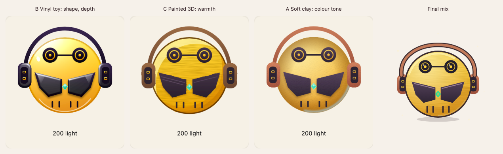
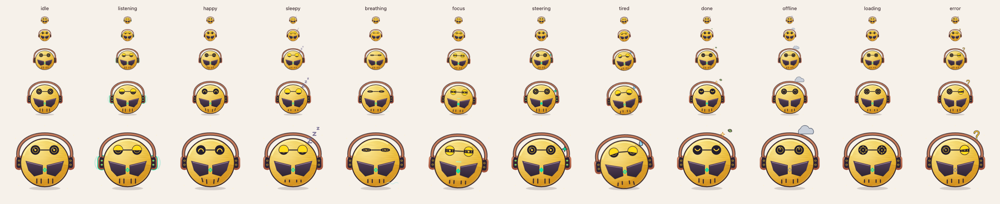

# Zonked mascot: character sheet

Source of truth for the look of the mascot. The drawing is `web/src/ui/calm/mascot/` (SVG plus CSS, no images). The same geometry makes the icons.

Left: the 2018 logo as committed at 96d55ca. Middle: the new mascot at hero size. Right: the new `logo.svg`, favicon, apple touch icon and maskable icon.

## Head only rule

The owner asked to keep only the head in every situation. Never add a body, clothes, limbs or a seat back. Breath moves the head itself. The head fills the box (transform `translate(46.1 56.1) scale(.82)` on the 2018 coordinates), and props sit around it inside the box.

## Identity rules (never change)

All numbers are in the 512 unit space of the 2018 `logo.svg`.

| Part | Rule |
|---|---|
| Head | One circle, radius 200, centred at 256,256. Gold. The 2018 value was `#FFE600` to `#FFB800`. The drawing now uses a warmer matte gold, `#FBD84A` to `#E8A128`, a deliberate tone change (see the final look below). |
| Outline | One closed ring around the head. |
| Eyes | Two ring eyes at 178,150 and 334,150. Dark disc r40, gold ring r24, gold pupil r7. A short bar joins them at y146. |
| Mask | Two dark angular plates, left `96,240 240,276 240,350 168,370 120,320`, right mirrored `416,240 272,276 272,350 344,370 392,320`. A gap of 32 between them. |
| Gem | A teal diamond `#00E5A8` in the gap, centre 256,316, half width 14. |
| Mouth | Four vertical slits at x 190, 226, 286, 322, y 392 to 426. Moods may bend or shorten the row. They never become a curve or a line. |
| Ear pods | Two dark rounded rectangles, 40 by 88, at x 22 and 450, each with two small slits. |
| Proportions | Eyes in the upper third, plates in the middle, slits low. Pods sit on the left and right edge of the head. |
| Ids in `logo.svg` | `ear-left`, `ear-right`, `eye-left`, `eye-right`, `plate-left`, `plate-right`, `phase-diamond`, and the first `r=200` circle. The Studio mascot animates them by id. |

## What the style may change

| Allowed | How it is done |
|---|---|
| Ink line with weight variation | A 8 px ink ring plus a 6 px dashed overlay. No wobble filter any more. |
| Matte warm fill | The gold gradient, a warm key light at the top left, a hard cel shadow crescent at the lower right, a thin cool rim line, and a light brush grain from 72 px. |
| Dark mask colour | Softer plum, `#54415A` at the top to `#2E2433`, with a light bevel line on the top edge of each plate. |
| Headphones | A terracotta band (`#C27A5A`) over the head that ends in a terracotta cup (`#CC7F5E` to `#9C4F3A`) around each ear pod, with a small bevel highlight. |
| Head only | The mascot is the head, the headphones and the mood prop. No body, hoodie, arms, feet or hill, at every size and mood. A soft round shadow sits under the head. |
| 3D | Layers at different depth. The head tilts up to 8 degrees toward the pointer. |

Not allowed: changing the plate shapes, the number of slits, the eye rings, the head shape or the gold. No new characters, no faces with curved mouths.

## Moods and props

Props: `mood`, `size`, `reducedMotion`, `label`, `breathPhase`, `level`, `situation`. New moods only add values.

| Mood | Where used | Eyes (`data-eye`) | Prop (`data-prop`) | Slits | Motion |
|---|---|---|---|---|---|
| idle | default | ring | none | straight | float 5 s, seeded blink every 4 to 7 s |
| listening | sound plays | half | ripples | straight | head sway 6 s, ripples follow `level` |
| happy | success | arc (upturned) | none | smile, outer slits tilt out | one small bounce |
| sleepy | sleep timer | lid (low) | zzz | short | slow drooping nod 7 s, letters drift up |
| breathing | player | ring, closes on exhale | wisp | follow `breathPhase` | the head scales about 3 percent and lifts on inhale, eyes close on exhale |
| focus | focus journeys | narrow | glow (line on gem) | short | forward lean, no blink |
| steering | crew steers the sound | ring | spark (near ear pod) | straight | gem pulse once per 3 s |
| tired | burned out step | heavy (tilted lid) | sweat | frown | head drops, blink every 6 to 11 s |
| done | end card | closed (arcs) | leaf and sparkle | small smile | prop floats down 6 s |
| offline | no bridge | up (pupils look up) | cloud | uneven | slow float, grey gem |
| loading | waiting | dial (ticks turn) | none | short | dial turns once in 14 s |
| error | failed load | ring and squint | question | uneven | slow float, never red |

Each mood is a pair of eye shape and prop, so no two match. Props are drawn only for their mood. Listening uses the sound ripples as its prop.

Rules: every loop is 1 second or slower, so no flash exceeds 3 per second. Blinks use a seeded timer and stop on unmount. All animation pauses while the tab is hidden. Reduced motion (the prop or the OS setting) removes all animation and the pointer turn. The turn is up to 6 degrees, smoothed by a CSS transition, throttled to one update per 50 ms, and runs only on a fine pointer (mouse or pen). Touch gets none. Device tilt is used only when the accelerometer permission is already granted. The mascot never asks.

## Sizes

| Size | Drawn |
|---|---|
| 24 (nav), 40 | Head, pods and band only, cropped. No filter, no grain, no shade, no key light. Bold flat shapes. |
| 72 (headers) | Same crop, plus grain, key light, cel shadow and rim. This is the first size with the one grain filter. |
| 120 (onboarding) | Head with headphones, ground shadow. |
| 190 and up (player scene) | Head, ground shadow, motes, ripples, paint filter. |

## Themes

| Variant | Switch |
|---|---|
| Light | default |
| Dark | `[data-theme='dark']` ancestor: darker ground shadow, lighter band line |
| High contrast | `[data-contrast='high']` ancestor: black or white ink |
| Forced colors | `@media (forced-colors: active)`: Canvas and CanvasText only, no shadow or glow |

## Icons

Made from the same coordinates by a script in the working folder, then rendered with playwright. File names did not change.

| File | Notes |
|---|---|
| `web/public/logo.svg` | Dark disc as in 2018, new head at 90 percent. Keeps the ids above. |
| `web/public/favicon.svg` | Same, thicker lines, no small details. |
| `web/public/pwa-192x192.png`, `pwa-512x512.png` | From `logo.svg`, transparent corners. |
| `web/public/maskable-512x512.png` | Full square, drawing inside the central 80 percent circle. |
| `web/public/apple-touch-icon.png` | 180, full square. |
| `app/assets/icon.png` | 512 by 512, RGB, no alpha. |

## Final look: a mix of three concepts

| From | Taken |
|---|---|
| B Vinyl toy | Bold bevelled shapes: light bevel line on each plate and cup, five depth layers (shadow, ripples, face, band, props and motes), the head turns toward the pointer. Stays clear at 24 and 40 px. No gloss highlights, no lacquer. |
| C Painted 3D | Warm key light, hard cel shadow crescent, light brush grain, ink line. The torn displacement edges were dropped, because they looked ragged at 200 px. |
| A Soft clay | The matte warm gold, the softer plum mask and the terracotta band and cups. A thin cool rim line, without A's blurred rim that read as a grey smudge. |

Filters: one grain filter per instance, only from 72 px. Nothing animates a filter. The old head drop shadow, the pod glow and the gem glow were removed (the ground shadow and strokes do those jobs).

## How close is it

Honest view after looking at the shots:

- Final mix, honest view: it is warmer and less glossy than B, and not as shiny as the 2018 neon. It still reads a bit stern at rest because the plates are large and dark. A pale patch from my first cel shadow cap showed at the right edge in the first render; I switched to a flat-ended arc and it is gone. Grain shows as light horizontal streaks and is easy to see at 200 px. At 24 px the moods differ little.
- The parts match the original one to one: ring eyes joined by a bar, two angular plates, teal gem in the gap, four slits, side pods. A person who knows the 2018 logo should see it at once, mostly from the plates and the gem.
- It is not the same picture. The original is a neon outline on black. The new one is a filled gold head with dark plates. The plates are large and dark, so at rest the face can still read as stern. I softened the colour and corners but kept the silhouette, as the rules require.
- Moods differ mainly by eyes, slits and pose. At 24 px only happy, sleepy, tired and the plain faces can be told apart. Glow moods (steering, listening) are clear only from 72 px.
- The body was removed. Only the head stays, in every situation.
- Not checked: real devices, a screen reader pass, forced-colors in a real browser (rules were written, not seen), motion at real speed.
