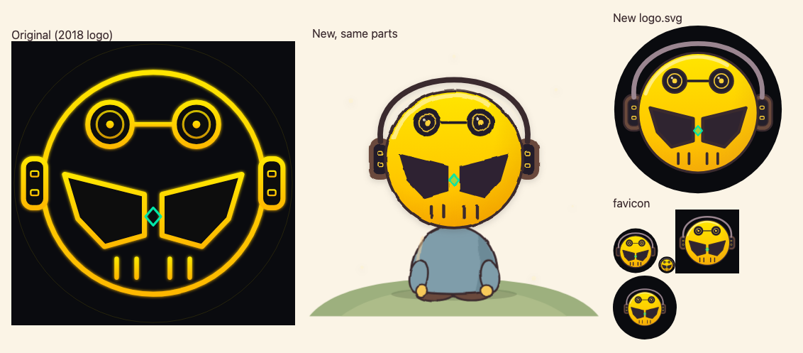
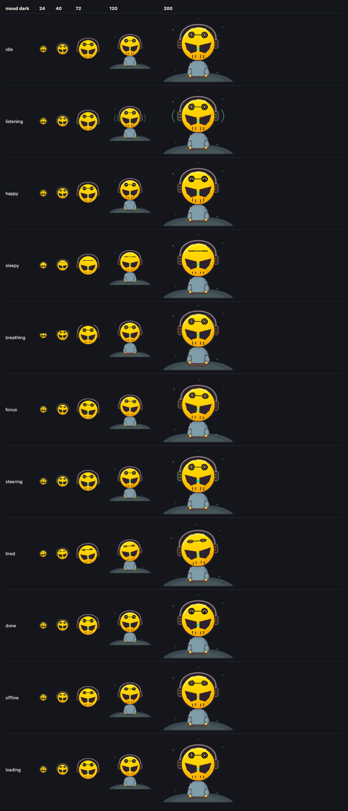

# Zonked mascot: character sheet

Source of truth for the look of the mascot. The drawing is `web/src/ui/calm/mascot/` (SVG plus CSS, no images). The same geometry makes the icons.

Left: the 2018 logo as committed at 96d55ca. Middle: the new mascot at hero size. Right: the new `logo.svg`, favicon, apple touch icon and maskable icon.

## Identity rules (never change)

All numbers are in the 512 unit space of the 2018 `logo.svg`.

| Part | Rule |
|---|---|
| Head | One circle, radius 200, centred at 256,256. Gold: `#FFE600` at the top to `#FFB800` at the bottom. |
| Outline | One closed ring around the head. |
| Eyes | Two ring eyes at 178,150 and 334,150. Dark disc r40, gold ring r24, gold pupil r7. A short bar joins them at y146. |
| Mask | Two dark angular plates, left `96,240 240,276 240,350 168,370 120,320`, right mirrored `416,240 272,276 272,350 344,370 392,320`. A gap of 32 between them. |
| Gem | A teal diamond `#00E5A8` in the gap, centre 256,316, half width 14. |
| Mouth | Four vertical slits at x 190, 226, 286, 322, y 392 to 426. Moods may bend or shorten the row. They never become a curve or a line. |
| Ear pods | Two dark rounded rectangles, 40 by 88, at x 22 and 450, each with two small slits. |
| Proportions | Eyes in the upper third, plates in the middle, slits low. Pods sit on the left and right edge of the head. |
| Ids in `logo.svg` | `ear-left`, `ear-right`, `eye-left`, `eye-right`, `plate-left`, `plate-right`, `phase-diamond`, and the first `r=200` circle. The Studio mascot animates them by id. |

## What the style may change

| Allowed | How it is done |
|---|---|
| Ink line with weight variation | A 8 px ink ring plus a 6 px dashed overlay, and a small wobble filter above 96 px. |
| Soft watercolor fill | The gold gradient, a warm radial shade at the lower right, and a pale rim light arc at the top left. |
| Dark mask colour | Warm plum `#2F2430` with rounded line joins, instead of the 2018 near black with neon. |
| Headphones | A band over the head that ends in a brown cup around each ear pod. The pod is the inner part of the cup, so nothing is drawn twice. |
| Body | A small blue-grey body sitting on a green hill, shown from 120 px up. |
| 3D | Layers at different depth. The head tilts up to 8 degrees toward the pointer. |

Not allowed: changing the plate shapes, the number of slits, the eye rings, the head shape or the gold. No new characters, no faces with curved mouths.

## Moods and props

Props: `mood`, `size`, `reducedMotion`, `label`, `breathPhase`, `level`, `situation`. New moods only add values.

| Mood | Where used | Eyes | Mouth slits | Motion |
|---|---|---|---|---|
| idle | default | open, slow blink | straight | float 5 s |
| listening | sound plays | open | straight | pods glow and ripples follow `level` |
| happy | success | closed arcs | bent up | soft bounce 2.4 s |
| sleepy | sleep timer | nearly shut | short | float 8 s, a "z" |
| breathing | player | open | follow `breathPhase` | 4 in, 4 out, driven from outside |
| focus | focus journeys | steady, no blink | short | slight lean, 16 s sway |
| steering | crew steers the sound | open | straight | cyan glow on gem and pods, 3.4 s |
| tired | crew demo, burned out step | half shut | bent down | head drops and tilts |
| done | end card | closed arcs | small smile | float 9 s |
| offline, error | no bridge, failed load | open, pupils dim | uneven | slow float, grey gem, never red |
| loading | waiting | ring eyes dashed | short | dashes turn once in 12 s |

Rules: every loop is 1 second or slower, so no flash exceeds 3 per second. Reduced motion (the prop or the OS setting) removes all animation and the pointer tilt.

## Sizes

| Size | Drawn |
|---|---|
| 24 (nav), 40 | Head, pods and band only, cropped. No paint filter, no shade. Thicker lines. |
| 72 (headers) | Same as 40. |
| 120 (onboarding) | Full figure with hill. |
| 190 and up (player scene) | Full figure, motes, ripples, paint filter. |

## Themes

| Variant | Switch |
|---|---|
| Light | default |
| Dark | `[data-theme='dark']` ancestor: darker hill, lighter band line |
| High contrast | `[data-contrast='high']` ancestor: black or white ink |
| Forced colors | `@media (forced-colors: active)`: Canvas and CanvasText only, no hill or glow |

## Icons

Made from the same coordinates by a script in the working folder, then rendered with playwright. File names did not change.

| File | Notes |
|---|---|
| `web/public/logo.svg` | Dark disc as in 2018, new head at 90 percent. Keeps the ids above. |
| `web/public/favicon.svg` | Same, thicker lines, no small details. |
| `web/public/pwa-192x192.png`, `pwa-512x512.png` | From `logo.svg`, transparent corners. |
| `web/public/maskable-512x512.png` | Full square, drawing inside the central 80 percent circle. |
| `web/public/apple-touch-icon.png` | 180, full square. |
| `app/assets/icon.png` | 512 by 512, RGB, no alpha. |

## How close is it

Honest view after looking at the shots:

- The parts match the original one to one: ring eyes joined by a bar, two angular plates, teal gem in the gap, four slits, side pods. A person who knows the 2018 logo should see it at once, mostly from the plates and the gem.
- It is not the same picture. The original is a neon outline on black. The new one is a filled gold head with dark plates. The plates are large and dark, so at rest the face can still read as stern. I softened the colour and corners but kept the silhouette, as the rules require.
- Moods differ mainly by eyes, slits and pose. At 24 px only happy, sleepy, tired and the plain faces can be told apart. Glow moods (steering, listening) are clear only from 72 px.
- The body is a plain blue-grey figure and is the weakest part. It has no link to the original.
- Not checked: real devices, a screen reader pass, forced-colors in a real browser (rules were written, not seen), motion at real speed.
